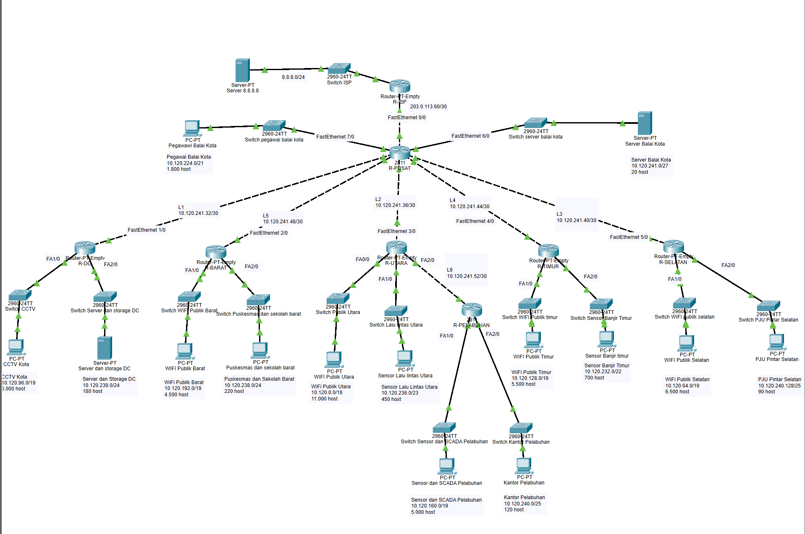
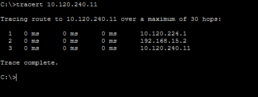
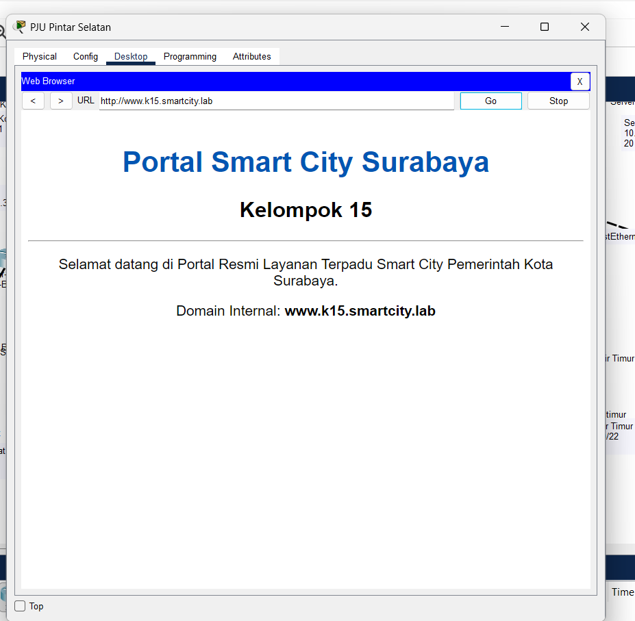

# Dokumentasi Mid-Project Komunikasi Data dan Jaringan Komputer
## Implementasi Jaringan Smart City Kota Surabaya

**Kelompok:** K15 *(Sesuaikan jika berbeda)*  
**Kelas:** [Isi Kelas Anda]  
**Anggota Kelompok:**
1. [Nayarfa Syamahira Dyamanta]  - [5027251046] *(Soal 2 - sebagian , 6 , 8 )*
2. [Nama Anggota 2] - [NRP] *(Soal ...)*
3. [Muhamad Nasrulhaq] - [5027251117] *(Soal 1, 3, 4)*
4. [Nama Anggota 4] - [NRP] *(Soal ...)*

---

## Daftar Isi
1. [Soal 1: Perancangan Topologi & Pemilihan Skema](#1-soal-1-perancangan-topologi--pemilihan-skema)
2. [Soal 2: Tabel Subnetting (VLSM & CIDR)](#2-soal-2-tabel-subnetting-vlsm--cidr)
3. [Penjelasan Konfigurasi Jaringan (Soal 3 – Soal 8)](#3-penjelasan-konfigurasi-jaringan-soal-3--soal-8)
   - [Soal 3: Static Routing](#31-soal-3-static-routing)
   - [Soal 4: Layanan DHCP Server & DHCP Relay](#32-soal-4-layanan-dhcp-server--dhcp-relay)
   - [Soal 5: Network Address Translation (NAT)](#33-soal-5-network-address-translation-nat)
   - [Soal 6: Tunnel GRE](#34-soal-6-tunnel-gre)
   - [Soal 7: Dynamic Routing OSPF](#35-soal-7-dynamic-routing-ospf)
   - [Soal 8: Layanan Aplikasi Smart City](#36-soal-8-layanan-aplikasi-smart-city)
4. [Bukti Pengujian Mandiri (Screenshots)](#4-bukti-pengujian-mandiri-screenshots)

---

## 1. Soal 1: Perancangan Topologi & Pemilihan Skema

### 1.1 Gambar Topologi Keseluruhan
Berikut adalah hasil perancangan topologi jaringan *Smart City* Kota Surabaya pada Cisco Packet Tracer menggunakan skema pengalamatan **VLSM (*Variable Length Subnet Mask*)**:



---

### 1.2 Alasan Pemilihan Skema (VLSM)
Kelompok kami memilih skema **VLSM (*Variable Length Subnet Mask*)** untuk diimplementasikan pada jaringan *Smart City* Kota Surabaya berdasarkan pertimbangan teknis berikut:
1. **Efisiensi Alokasi Ruang Alamat IP:** Kebutuhan jumlah *host* di setiap wilayah dan layanan sangat bervariasi, mulai dari jaringan berskala besar seperti **WiFi Publik Utara** ($11.000\text{ host}$, membutuhkan prefix `/18`) dan **WiFi Publik Selatan** ($6.500\text{ host}$, membutuhkan prefix `/19`), hingga jaringan berskala kecil seperti **Server Balai Kota** ($20\text{ host}$, membutuhkan prefix `/27`) serta *link backbone* antar-router **L1–L6** ($2\text{ host}$, membutuhkan prefix `/30`). Dengan VLSM, ukuran blok subnet dapat disesuaikan secara presisi mengikuti rumus kapasitas $2^n - 2$ tanpa membuang banyak alamat IP yang tidak terpakai.
2. **Skalabilitas untuk *Link Point-to-Point*:** Penggunaan prefix `/30` (`255.255.255.252`) pada seluruh jalur *backbone* antar-router (L1 hingga L6) hanya menggunakan 4 alamat IP per link (2 alamat *host* aktif), sehingga menghemat ruang alamat privat blok `10.120.0.0/16` untuk kebutuhan ekspansi sensor atau layanan kota di masa mendatang.
3. **Kemudahan Manajemen Layanan Spesifik:** Setiap LAN memiliki batas *broadcast domain* yang jelas sesuai kapasitas nyatanya, sehingga lalu lintas *broadcast* (seperti *ARP* dan *DHCP Request* dari ribuan pengguna WiFi publik) tetap terisolasi di masing-masing subnet.

---

### 1.3 Penjelasan Desain Topologi
Sesuai dengan ketentuan perancangan, berikut adalah rincian arsitektur, pemilihan perangkat, media transmisi, dan penamaan yang kami terapkan:

1. **Struktur Hierarki & *Backbone* Antar-Router:**
   * **Tier Eksternal (ISP & Internet):** `R-ISP` berperan sebagai penyedia layanan internet yang menghubungkan jaringan internal *Smart City* ke `Server 8.8.8.8` (`8.8.8.0/24`) dan terhubung ke router utama melalui subnet publik `203.0.113.60/30` (di mana $4 \times K = 60$ untuk Kelompok 15).
   * **Tier Pusat (*Core*):** `R-PUSAT` yang berlokasi di Balai Kota berfungsi sebagai *core router* yang mendistribusikan koneksi ke 2 LAN internal Balai Kota (Pegawai dan Server) serta 5 router wilayah melalui *link* L1 hingga L5.
   * **Tier Distribusi Wilayah:** Terdiri atas `R-DC` (*Command Center* via L1), `R-UTARA` (Surabaya Utara via L2), `R-SELATAN` (Surabaya Selatan via L3), `R-TIMUR` (Surabaya Timur via L4), dan `R-BARAT` (Surabaya Barat via L5).
   * **Tier Sub-Wilayah:** `R-PELABUHAN` terhubung secara berjenjang di bawah `R-UTARA` melalui *link* L6 (`10.120.241.52/30`) karena secara geografis berada di kawasan Surabaya Utara.

2. **Pemilihan Perangkat & Penambahan Modul Port:**
   * **Router (`2811` / `Router-PT-Empty`):** Digunakan karena mendukung penambahan modul slot kartu jaringan (*Network Module*). Khusus pada `R-PUSAT`, kami menambahkan modul antarmuka *FastEthernet* hingga memiliki **8 port aktif (`Fa0/0` s/d `Fa7/0`)** untuk mengakomodasi 1 *link* ke `R-ISP`, 5 *link backbone* (L1–L5), dan 2 *link* LAN lokal Balai Kota.
   * **Switch (`Cisco Catalyst 2960-24TT`):** Dipasang sebanyak 1 unit pada setiap LAN (total 15 Switch) sebagai konsentrator *Layer 2* untuk menghubungkan *port* gateway router dengan perangkat akhir (*end-devices*). Pemilihan switch 24-port ini merepresentasikan kesiapan jaringan untuk dihubungkan ke banyak *access point*, sensor IoT, maupun komputer pegawai di dunia nyata.
   * **Perangkat Akhir (*End-Devices*):** Sesuai instruksi soal, dipasang 1 perangkat perwakilan pada setiap LAN. Kami menggunakan `Server-PT` pada 3 jaringan penyedia layanan (`Server dan storage DC`, `Server Balai Kota`, dan `Server 8.8.8.8`), serta menggunakan `PC-PT` untuk merepresentasikan perangkat pengguna, *controller* sensor, PJU pintar, SCADA, dan unit CCTV Kota.

3. **Pemilihan Media Transmisi (Kabel):**
   * **Kabel *Copper Cross-Over* (Garis Putus-Putus):** Digunakan pada seluruh koneksi *backbone* antar-router (`R-ISP` ke `R-PUSAT`, serta L1 sampai L6) karena menghubungkan dua perangkat yang bekerja pada lapisan yang sama (*router-to-router*).
   * **Kabel *Copper Straight-Through* (Garis Lurus):** Digunakan untuk menghubungkan *interface* router ke switch (*router-to-switch*) serta dari switch menuju PC dan Server (*switch-to-end-device*). Media kabel tembaga (*FastEthernet*) dipilih karena memberikan koneksi yang stabil, latensi rendah, serta mendukung *bandwidth* penuh untuk lalu lintas CCTV dan sensor SCADA.

4. **Standar Penamaan & Pelabelan Subnet:**
   * Seluruh perangkat telah diubah namanya dari nama bawaan menjadi nama yang merepresentasikan fungsi dan lokasinya, seperti `R-PUSAT`, `R-DC`, `Switch CCTV`, `CCTV Kota`, hingga `Server dan storage DC`.
   * Setiap segmen LAN dan *link backbone* dilengkapi label visual yang memuat **Nama Subnet**, **Network ID beserta Prefix**, dan **Kapasitas Jumlah Host** (contoh: `WiFi Publik Utara | 10.120.0.0/18 | 11.000 host`).

---

## 2. Soal 2: Tabel Subnetting (VLSM & CIDR)

> **[PLACEHOLDER SOAL 2 - BAGIAN REKAN KELOMPOK]**  
> *Silakan lengkapi tabel perhitungan VLSM, CIDR (Supernetting), dan Tabel Revisi UTS di bagian ini.*

### 2.1 Tabel Alokasi Pengalamatan VLSM
| No | Nama Subnet / Lokasi | Kebutuhan Host | Network ID | Prefix | Subnet Mask | Rentang Host Valid | Broadcast Address | Gateway |
| :--- | :--- | :--- | :--- | :--- | :--- | :--- | :--- | :--- |
| 1 | WiFi Publik Utara | 11.000 | `10.120.0.0` | `/18` | `255.255.192.0` | `10.120.0.1` - `10.120.63.254` | `10.120.63.255` | `10.120.0.1` |
| 2 | WiFi Publik Selatan | 6.500 | `10.120.64.0` | `/19` | `255.255.224.0` | `10.120.64.1` - `10.120.95.254` | `10.120.95.255` | `10.120.64.1` |
| 3 | CCTV Kota (DC) | 6.000 | `10.120.96.0` | `/19` | `255.255.224.0` | `10.120.96.1` - `10.120.127.254` | `10.120.127.255` | `10.120.96.1` |
| ... | *[Lengkapi sisa baris sesuai Spreadsheet]* | ... | ... | ... | ... | ... | ... | ... |

### 2.2 Tabel Revisi Perhitungan UTS (Jika Ada)
| No | Nama Subnet | Jawaban Saat UTS | Perbaikan Saat Mid-Project | Alasan Kesalahan / Perbaikan |
| :--- | :--- | :--- | :--- | :--- |
| 1 | *[Placeholder]* | *[Placeholder]* | *[Placeholder]* | *[Placeholder]* |

---

## 3. Penjelasan Konfigurasi Jaringan (Soal 3 – Soal 8)

### 3.1 Soal 3: Static Routing

#### A. Konsep dan Aturan Konfigurasi Static Routing
Agar seluruh LAN di semua wilayah dapat saling berkomunikasi tanpa protokol *dynamic routing*, kami menerapkan skema **Static Routing berjenjang (Hierarkis)** sesuai ketentuan soal:
1. **Aturan *Default Route* (`0.0.0.0 0.0.0.0`):** *Default route* hanya dikonfigurasi mengarah ke router di atasnya (*upstream* / ke arah luar). 
   * Router ujung (`R-DC`, `R-BARAT`, `R-TIMUR`, `R-SELATAN`) mengarahkan *default route* ke `R-PUSAT`.
   * `R-PELABUHAN` mengarahkan *default route* ke `R-UTARA` (`10.120.241.53`).
   * `R-UTARA` mengarahkan *default route* ke `R-PUSAT` (`10.120.241.37`).
   * `R-PUSAT` mengarahkan *default route* keluar menuju `R-ISP` (`203.0.113.62`).
2. **Aturan *Static Route* Spesifik (Arah ke Dalam / *Downstream*):**
   * **`R-PUSAT`** memiliki 12 baris *static route* spesifik yang memetakan seluruh subnet LAN di bawah kendali `R-DC`, `R-UTARA`, `R-PELABUHAN` (diteruskan lewat *next-hop* `R-UTARA`), `R-SELATAN`, `R-TIMUR`, dan `R-BARAT`.
   * **`R-UTARA`** memiliki 2 baris *static route* spesifik untuk meneruskan paket yang menuju jaringan di bawahnya, yaitu LAN Sensor & SCADA Pelabuhan (`10.120.160.0/19`) dan LAN Kantor Pelabuhan (`10.120.240.0/25`) melalui *next-hop* `R-PELABUHAN` (`10.120.241.54`).

#### B. Rincian Konfigurasi Interface & Static Routing per Router

##### 1) Router Pusat (`R-PUSAT`)
```text
enable                                              ! Masuk ke Privileged EXEC Mode
configure terminal                                  ! Masuk ke Global Configuration Mode
hostname R-PUSAT                                    ! Mengubah nama identitas router menjadi R-PUSAT
no ip domain-lookup                                 ! Mencegah router melakukan pencarian DNS saat salah ketik perintah

! --- Konfigurasi Interface ---
interface FastEthernet 0/0
 description ke R-ISP
 ip address 203.0.113.61 255.255.255.252            ! IP publik point-to-point (/30) ke arah R-ISP
 no shutdown
interface FastEthernet 1/0
 description L1 ke R-DC
 ip address 10.120.241.33 255.255.255.252           ! IP point-to-point (/30) untuk link L1
 no shutdown
interface FastEthernet 2/0
 description L5 ke R-BARAT
 ip address 10.120.241.49 255.255.255.252           ! IP point-to-point (/30) untuk link L5
 no shutdown
interface FastEthernet 3/0
 description L2 ke R-UTARA
 ip address 10.120.241.37 255.255.255.252           ! IP point-to-point (/30) untuk link L2
 no shutdown
interface FastEthernet 4/0
 description L4 ke R-TIMUR
 ip address 10.120.241.45 255.255.255.252           ! IP point-to-point (/30) untuk link L4
 no shutdown
interface FastEthernet 5/0
 description L3 ke R-SELATAN
 ip address 10.120.241.41 255.255.255.252           ! IP point-to-point (/30) untuk link L3
 no shutdown
interface FastEthernet 6/0
 description LAN Server Balai Kota
 ip address 10.120.241.1 255.255.255.224            ! IP Gateway pertama (/27) untuk LAN Server Balai Kota
 no shutdown
interface FastEthernet 7/0
 description LAN Pegawai Balai Kota
 ip address 10.120.224.1 255.255.248.0              ! IP Gateway pertama (/21) untuk LAN Pegawai Balai Kota
 no shutdown
exit

! --- Konfigurasi Static Routing ---
ip route 0.0.0.0 0.0.0.0 203.0.113.62               ! Default route keluar menuju internet lewat next-hop R-ISP
ip route 10.120.96.0 255.255.224.0 10.120.241.34    ! Rute statis ke LAN CCTV Kota (/19) via next-hop R-DC
ip route 10.120.239.0 255.255.255.0 10.120.241.34   ! Rute statis ke LAN Server & Storage DC (/24) via next-hop R-DC
ip route 10.120.0.0 255.255.192.0 10.120.241.38     ! Rute statis ke LAN WiFi Publik Utara (/18) via next-hop R-UTARA
ip route 10.120.236.0 255.255.254.0 10.120.241.38   ! Rute statis ke LAN Sensor Lantas Utara (/23) via next-hop R-UTARA
ip route 10.120.64.0 255.255.224.0 10.120.241.42    ! Rute statis ke LAN WiFi Publik Selatan (/19) via next-hop R-SELATAN
ip route 10.120.240.128 255.255.255.128 10.120.241.42 ! Rute statis ke LAN PJU Pintar Selatan (/25) via next-hop R-SELATAN
ip route 10.120.128.0 255.255.224.0 10.120.241.46   ! Rute statis ke LAN WiFi Publik Timur (/19) via next-hop R-TIMUR
ip route 10.120.232.0 255.255.252.0 10.120.241.46   ! Rute statis ke LAN Sensor Banjir Timur (/22) via next-hop R-TIMUR
ip route 10.120.192.0 255.255.224.0 10.120.241.50   ! Rute statis ke LAN WiFi Publik Barat (/19) via next-hop R-BARAT
ip route 10.120.238.0 255.255.255.0 10.120.241.50   ! Rute statis ke LAN Puskesmas & Sekolah Barat (/24) via R-BARAT
ip route 10.120.160.0 255.255.224.0 10.120.241.38   ! Rute statis ke LAN Sensor & SCADA Pelabuhan (/19) via R-UTARA
ip route 10.120.240.0 255.255.255.128 10.120.241.38 ! Rute statis ke LAN Kantor Pelabuhan (/25) via next-hop R-UTARA
```

##### 2) Router Surabaya Utara (`R-UTARA`)
```text
enable
configure terminal
hostname R-UTARA
no ip domain-lookup

! --- Konfigurasi Interface ---
interface FastEthernet 0/0
 description LAN WiFi Publik Utara
 ip address 10.120.0.1 255.255.192.0                ! IP Gateway pertama (/18) untuk LAN WiFi Publik Utara
 no shutdown
interface FastEthernet 1/0
 description LAN Sensor Lalu Lintas Utara
 ip address 10.120.236.1 255.255.254.0              ! IP Gateway pertama (/23) untuk LAN Sensor Lantas Utara
 no shutdown
interface FastEthernet 2/0
 description L6 ke R-PELABUHAN
 ip address 10.120.241.53 255.255.255.252           ! IP point-to-point (/30) untuk link L6
 no shutdown
interface FastEthernet 3/0
 description L2 ke R-PUSAT
 ip address 10.120.241.38 255.255.255.252           ! IP point-to-point (/30) untuk link L2
 no shutdown
exit

! --- Konfigurasi Static Routing ---
ip route 0.0.0.0 0.0.0.0 10.120.241.37              ! Default route ke arah luar/atas menuju next-hop R-PUSAT
ip route 10.120.160.0 255.255.224.0 10.120.241.54   ! Rute statis ke dalam menuju LAN SCADA Pelabuhan (/19) via R-PELABUHAN
ip route 10.120.240.0 255.255.255.128 10.120.241.54 ! Rute statis ke dalam menuju LAN Kantor Pelabuhan (/25) via R-PELABUHAN
```

##### 3) Router Command Center (`R-DC`), `R-PELABUHAN`, `R-SELATAN`, `R-TIMUR`, `R-BARAT`, dan `R-ISP`
```text
! ==========================================
! KONFIGURASI R-DC
! ==========================================
enable
configure terminal
hostname R-DC
no ip domain-lookup
interface FastEthernet 0/0
 description L1 ke R-PUSAT
 ip address 10.120.241.34 255.255.255.252
 no shutdown
interface FastEthernet 1/0
 description LAN CCTV Kota
 ip address 10.120.96.1 255.255.224.0
 no shutdown
interface FastEthernet 2/0
 description LAN Server dan Storage DC
 ip address 10.120.239.1 255.255.255.0
 no shutdown
exit
ip route 0.0.0.0 0.0.0.0 10.120.241.33              ! Default route satu pintu menuju R-PUSAT

! ==========================================
! KONFIGURASI R-PELABUHAN
! ==========================================
enable
configure terminal
hostname R-PELABUHAN
no ip domain-lookup
interface FastEthernet 0/0
 description L6 ke R-UTARA
 ip address 10.120.241.54 255.255.255.252
 no shutdown
interface FastEthernet 1/0
 description LAN Sensor dan SCADA Pelabuhan
 ip address 10.120.160.1 255.255.224.0
 no shutdown
interface FastEthernet 2/0
 description LAN Kantor Pelabuhan
 ip address 10.120.240.1 255.255.255.128
 no shutdown
exit
ip route 0.0.0.0 0.0.0.0 10.120.241.53              ! Default route satu pintu menuju R-UTARA

! ==========================================
! KONFIGURASI R-SELATAN
! ==========================================
enable
configure terminal
hostname R-SELATAN
no ip domain-lookup
interface FastEthernet 0/0
 description L3 ke R-PUSAT
 ip address 10.120.241.42 255.255.255.252
 no shutdown
interface FastEthernet 1/0
 description LAN WiFi Publik Selatan
 ip address 10.120.64.1 255.255.224.0
 no shutdown
interface FastEthernet 2/0
 description LAN PJU Pintar Selatan
 ip address 10.120.240.129 255.255.255.128
 no shutdown
exit
ip route 0.0.0.0 0.0.0.0 10.120.241.41              ! Default route satu pintu menuju R-PUSAT

! ==========================================
! KONFIGURASI R-TIMUR
! ==========================================
enable
configure terminal
hostname R-TIMUR
no ip domain-lookup
interface FastEthernet 0/0
 description L4 ke R-PUSAT
 ip address 10.120.241.46 255.255.255.252
 no shutdown
interface FastEthernet 1/0
 description LAN WiFi Publik Timur
 ip address 10.120.128.1 255.255.224.0
 no shutdown
interface FastEthernet 2/0
 description LAN Sensor Banjir Timur
 ip address 10.120.232.1 255.255.252.0
 no shutdown
exit
ip route 0.0.0.0 0.0.0.0 10.120.241.45              ! Default route satu pintu menuju R-PUSAT

! ==========================================
! KONFIGURASI R-BARAT
! ==========================================
enable
configure terminal
hostname R-BARAT
no ip domain-lookup
interface FastEthernet 0/0
 description L5 ke R-PUSAT
 ip address 10.120.241.50 255.255.255.252
 no shutdown
interface FastEthernet 1/0
 description LAN WiFi Publik Barat
 ip address 10.120.192.1 255.255.224.0
 no shutdown
interface FastEthernet 2/0
 description LAN Puskesmas dan Sekolah Barat
 ip address 10.120.238.1 255.255.255.0
 no shutdown
exit
ip route 0.0.0.0 0.0.0.0 10.120.241.49              ! Default route satu pintu menuju R-PUSAT

! ==========================================
! KONFIGURASI R-ISP
! ==========================================
enable
configure terminal
hostname R-ISP
interface FastEthernet 0/0
 description ke R-PUSAT
 ip address 203.0.113.62 255.255.255.252
 no shutdown
interface FastEthernet 1/0
 description ke server internet
 ip address 8.8.8.1 255.255.255.0
 no shutdown
exit
write memory
```

---

### 3.2 Soal 4: Layanan DHCP Server & DHCP Relay

#### A. Konsep dan Strategi Pengalamatan Dinamis (DHCP)
1. **Pengaturan IP Statis untuk Perangkat Infrastruktur:** Seluruh *interface* router dan ketiga server (`Server dan storage DC`, `Server Balai Kota`, dan `Server 8.8.8.8`) dikonfigurasi secara manual (*Static*) agar alamat *gateway* dan alamat penyedia layanan aplikasi (DNS, Web, FTP, DHCP) bersifat permanen dan tidak berubah.
2. **Pencegahan Konflik IP dengan `ip dhcp excluded-address`:** Pada setiap subnet LAN yang dilayani oleh DHCP router, kami mengecualikan **10 alamat IP pertama** (misalnya `.1` s/d `.10`, atau `.129` s/d `.138` pada PJU Pintar Selatan). Hal ini wajib dilakukan karena:
   * Mencegah *IP Conflict* (tabrakan alamat IP) antara klien DHCP dengan alamat *Default Gateway* milik router (`.1`).
   * Menyediakan ruang alamat IP cadangan (*reserved IP*) apabila di kemudian hari dipasang perangkat infrastruktur tambahan yang membutuhkan IP statis (seperti *Access Point* atau *Managed Switch*).
   * Oleh karena itu, setiap perangkat PC klien yang meminta IP via DHCP akan mendapatkan alokasi mulai dari alamat IP ke-11 (contoh: `.11` atau `.139`).
3. **Implementasi *DHCP Relay Agent* (`ip helper-address`) untuk CCTV Kota:** Sesuai instruksi khusus pada Soal 4, subnet **CCTV Kota** (`10.120.96.0/19`) di `R-DC` tidak dilayani oleh DHCP dari router, melainkan oleh **Server dan Storage DC (`10.120.239.2`)**. Karena paket *DHCP Discover* dari klien bersifat *broadcast* dan secara alami tidak dapat melewati router menuju subnet yang berbeda, kami memasang perintah `ip helper-address 10.120.239.2` pada `interface FastEthernet 1/0` di `R-DC`. Fitur ini membungkus dan meneruskan permintaan DHCP secara *unicast* menuju Server DC.

#### B. Rincian Konfigurasi IP Statis Server
Pada menu **Desktop -> IP Configuration** di masing-masing server:
* **Server dan Storage DC (`SRV-DC`):**
  * IPv4 Address: `10.120.239.2` | Subnet Mask: `255.255.255.0` | Default Gateway: `10.120.239.1` | DNS Server: `10.120.239.2`
* **Server Balai Kota (`SRV-BALAIKOTA`):**
  * IPv4 Address: `10.120.241.2` | Subnet Mask: `255.255.255.224` | Default Gateway: `10.120.241.1` | DNS Server: `10.120.239.2`
* **Server Internet (`Server 8.8.8.8`):**
  * IPv4 Address: `8.8.8.8` | Subnet Mask: `255.255.255.0` | Default Gateway: `8.8.8.1` | DNS Server: `-`

#### C. Rincian Konfigurasi DHCP Server & Relay pada Router
```text
! --- 1. DHCP Server pada R-PUSAT ---
ip dhcp excluded-address 10.120.224.1 10.120.224.10 ! Mencadangkan 10 IP awal LAN Pegawai Balai Kota
ip dhcp pool PEGAWAI-BALAIKOTA
 network 10.120.224.0 255.255.248.0
 default-router 10.120.224.1
 dns-server 10.120.239.2
exit
write memory

! --- 2. DHCP Server pada R-UTARA ---
ip dhcp excluded-address 10.120.0.1 10.120.0.10     ! Mencadangkan 10 IP awal LAN WiFi Utara
ip dhcp excluded-address 10.120.236.1 10.120.236.10 ! Mencadangkan 10 IP awal LAN Sensor Lantas Utara
ip dhcp pool WIFI-UTARA
 network 10.120.0.0 255.255.192.0
 default-router 10.120.0.1
 dns-server 10.120.239.2
ip dhcp pool SENSOR-LANTAS-UTARA
 network 10.120.236.0 255.255.254.0
 default-router 10.120.236.1
 dns-server 10.120.239.2
exit
write memory

! --- 3. DHCP Relay Agent pada R-DC (Khusus LAN CCTV Kota) ---
interface FastEthernet 1/0
 description LAN CCTV Kota
 ip helper-address 10.120.239.2                     ! Meneruskan paket DHCP Broadcast dari CCTV ke SRV-DC
exit
write memory

! --- 4. DHCP Server pada R-PELABUHAN ---
ip dhcp excluded-address 10.120.160.1 10.120.160.10
ip dhcp excluded-address 10.120.240.1 10.120.240.10
ip dhcp pool SCADA-PELABUHAN
 network 10.120.160.0 255.255.224.0
 default-router 10.120.160.1
 dns-server 10.120.239.2
ip dhcp pool KANTOR-PELABUHAN
 network 10.120.240.0 255.255.255.128
 default-router 10.120.240.1
 dns-server 10.120.239.2
exit
write memory

! --- 5. DHCP Server pada R-SELATAN ---
ip dhcp excluded-address 10.120.64.1 10.120.64.10
ip dhcp excluded-address 10.120.240.129 10.120.240.138
ip dhcp pool WIFI-SELATAN
 network 10.120.64.0 255.255.224.0
 default-router 10.120.64.1
 dns-server 10.120.239.2
ip dhcp pool PJU-SELATAN
 network 10.120.240.128 255.255.255.128
 default-router 10.120.240.129
 dns-server 10.120.239.2
exit
write memory

! --- 6. DHCP Server pada R-TIMUR ---
ip dhcp excluded-address 10.120.128.1 10.120.128.10
ip dhcp excluded-address 10.120.232.1 10.120.232.10
ip dhcp pool WIFI-TIMUR
 network 10.120.128.0 255.255.224.0
 default-router 10.120.128.1
 dns-server 10.120.239.2
ip dhcp pool SENSOR-BANJIR-TIMUR
 network 10.120.232.0 255.255.252.0
 default-router 10.120.232.1
 dns-server 10.120.239.2
exit
write memory

! --- 7. DHCP Server pada R-BARAT ---
ip dhcp excluded-address 10.120.192.1 10.120.192.10
ip dhcp excluded-address 10.120.238.1 10.120.238.10
ip dhcp pool WIFI-BARAT
 network 10.120.192.0 255.255.224.0
 default-router 10.120.192.1
 dns-server 10.120.239.2
ip dhcp pool PUSKESMAS-BARAT
 network 10.120.238.0 255.255.255.0
 default-router 10.120.238.1
 dns-server 10.120.239.2
exit
write memory
```

---

### 3.3 Soal 5: Network Address Translation (NAT)

> **[PLACEHOLDER SOAL 5 - BAGIAN REKAN KELOMPOK]**  
> *Silakan lengkapi penjelasan konsep NAT Overload (PAT) pada `R-PUSAT` serta blok perintah konfigurasinya di bawah ini.*

* **Penjelasan Konfigurasi NAT:** `[Placeholder Penjelasan NAT]`
* **Blok Perintah CLI pada `R-PUSAT`:**
```text
! [Placeholder Konfigurasi Access-List dan IP NAT Inside/Outside di R-PUSAT]
```

---

### 3.4 Soal 6: Tunnel GRE

#### Konfigurasi Tambahan Tunnel GRE

Konfigurasi di bawah ini **hanya tambahan untuk Soal 6**, ditambahkan di atas konfigurasi Soal 3 & 4 yang sudah ada.

#### R-PUSAT

```text
enable
configure terminal

! --- Interface Tunnel GRE ---
interface Tunnel0
 description GRE ke R-PELABUHAN
 ip address 192.168.15.1 255.255.255.252
 tunnel source FastEthernet0/1
 tunnel destination 10.120.241.54
 tunnel mode gre ip
 no shutdown
 exit

! --- Rute ke IP fisik R-PELABUHAN (link L6) ---
! Wajib ada: default route R-PUSAT mengarah ke R-ISP, jadi tanpa rute ini
! tunnel destination 10.120.241.54 tidak bisa dijangkau.
ip route 10.120.241.52 255.255.255.252 10.120.241.38

! --- Rute utama ke subnet Pelabuhan lewat tunnel (AD = 1) ---
ip route 10.120.160.0 255.255.224.0 192.168.15.2
ip route 10.120.240.0 255.255.255.128 192.168.15.2

! --- Rute cadangan lewat R-UTARA (floating static, AD = 5) ---
ip route 10.120.160.0 255.255.224.0 10.120.241.38 5
ip route 10.120.240.0 255.255.255.128 10.120.241.38 5

end
write memory
```

#### R-PELABUHAN

```text
enable
configure terminal

! --- Interface Tunnel GRE ---
interface Tunnel0
 description GRE ke R-PUSAT
 ip address 192.168.15.2 255.255.255.252
 tunnel source GigabitEthernet0/0
 tunnel destination 10.120.241.37
 tunnel mode gre ip
 no shutdown
 exit

! --- Rute ke IP fisik R-PUSAT (link L2) ---
ip route 10.120.241.36 255.255.255.252 10.120.241.53

! --- Rute ke subnet Balai Kota lewat tunnel ---
ip route 10.120.224.0 255.255.248.0 192.168.15.1
ip route 10.120.241.0 255.255.255.224 192.168.15.1

end
write memory
```

#### Uji dari PC (bukti lalu lintas lewat tunnel)

Cek dulu IP PC tujuan lewat **Desktop → IP Configuration**, karena IP dari DHCP bisa berbeda.

Dari **PC Pegawai Balai Kota** → **Desktop → Command Prompt**:

```text
tracert <IP PC Kantor Pelabuhan>
```

**Hasil yang benar:**




#### Mengapa router memilih jalur tunnel dibanding jalur lain ke Pelabuhan?

- **Di R-PUSAT:** ada dua rute ke subnet Pelabuhan dengan prefix yang sama. Rute lewat tunnel (`via 192.168.15.2`) memakai **Administrative Distance 1**, sedangkan rute lewat R-UTARA (`via 10.120.241.38`) memakai **AD 5** (*floating static route*). Router selalu memasang rute dengan AD terkecil ke tabel routing, jadi jalur tunnel menjadi jalur utama. Rute lewat R-UTARA hanya dipakai sebagai cadangan kalau rute tunnel hilang.
- **Di R-PELABUHAN:** jalur lain menuju Balai Kota hanya lewat *default route* `0.0.0.0/0 via 10.120.241.53`. Rute lewat tunnel memakai prefix yang jauh lebih spesifik (`/21` dan `/27`). Berdasarkan aturan **Longest Prefix Match**, router selalu memilih rute dengan prefix paling panjang, jadi lalu lintas ke Balai Kota masuk ke tunnel.

#### Mengapa GRE saja tidak mengenkripsi data?

GRE (*Generic Routing Encapsulation*, RFC 2784) adalah protokol **enkapsulasi**, bukan protokol keamanan. Tugasnya hanya membungkus paket asli dengan header GRE dan header IP baru, supaya paket bisa dikirim lewat jalur virtual *point-to-point*. GRE **tidak punya mekanisme kriptografi**: tidak ada enkripsi, tidak ada pengecekan integritas, dan tidak ada autentikasi. Akibatnya, isi paket di dalam tunnel tetap *plaintext* dan bisa dibaca oleh siapa pun yang menyadap jalur di tengah (misalnya di R-UTARA). Ini terlihat di Simulation Mode: header ICMP dan IP dalam tetap terbaca utuh. Untuk mengenkripsi data, GRE harus dikombinasikan dengan **IPsec** (GRE over IPsec).


---

### 3.5 Soal 7: Dynamic Routing OSPF

> **[PLACEHOLDER SOAL 7 - BAGIAN REKAN KELOMPOK]**  
> *Silakan lengkapi penjelasan penambahan link cadangan L7 (`R-DC` ke `R-UTARA`), konfigurasi OSPF, `passive-interface`, `default-information originate`, dan skenario failover.*

* **Penjelasan Konfigurasi OSPF & Link Cadangan L7:** `[Placeholder Penjelasan OSPF]`
* **Blok Perintah CLI OSPF:**
```text
! [Placeholder Konfigurasi router ospf di masing-masing router]
```

---

### 3.6 Soal 8: Layanan Aplikasi Smart City

### Soal 8a – DNS

> **Ketentuan:** DNS di LAN Server dan Storage DC. Nama `www`, `ftp`, dan `mail` dapat diakses dari seluruh wilayah.

####  Konfigurasi

**Server dan Storage DC → Services → DNS**

1. **DNS Service: On**
2. Tambahkan record berikut (Type `A Record`, klik **Add** di setiap baris):

| Name | Type | Address | Mengarah ke |
|---|---|---|---|
| `k15.smartcity.lab` | A Record | `10.120.241.2` | Server Balai Kota |
| `www.k15.smartcity.lab` | A Record | `10.120.241.2` | Server Balai Kota (Web) |
| `ftp.k15.smartcity.lab` | A Record | `10.120.239.2` | Server dan Storage DC (FTP) |
| `mail.k15.smartcity.lab` | A Record | `10.120.241.2` | Server Balai Kota (Email) |

#### Command Pengujian

Dari PC klien → **Desktop → Command Prompt**:

```text
ping www.k15.smartcity.lab
ping ftp.k15.smartcity.lab
ping mail.k15.smartcity.lab
```

**Hasil yang benar:** setiap nama domain diterjemahkan ke IP yang sesuai dan mendapat **Reply**.

#### Hasil


**Analisis:**

- `www.k15.smartcity.lab` → `10.120.241.2` ✅
- `ftp.k15.smartcity.lab` → `10.120.239.2` ✅
- `mail.k15.smartcity.lab` → `10.120.241.2` ✅
- Satu `Request timed out` di ping pertama itu normal. Paket pertama tertunda karena router masih mencari alamat MAC tujuan (proses ARP). Paket berikutnya semua berhasil.

---

#### – Soal 8b Web Portal

> **Ketentuan:** Web di LAN Server Balai Kota, berupa halaman "Portal Smart City Surabaya" yang mencantumkan nomor kelompok, dan dapat dibuka dengan nama domain dari semua wilayah.

#### Konfigurasi

**Server Balai Kota → Services → HTTP**

1. **HTTP: On** dan **HTTPS: On**
2. Edit file **`index.html`**, ganti isinya dengan:

```html
<html>
<head>
  <title>Portal Smart City Surabaya</title>
</head>
<body style="font-family: Arial, sans-serif; text-align: center; margin-top: 40px;">
  <h1 style="color: #0056b3;">Portal Smart City Surabaya</h1>
  <h2>Kelompok 15</h2>
  <hr>
  <p>Selamat datang di Portal Resmi Layanan Terpadu Smart City Pemerintah Kota Surabaya.</p>
  <p>Domain Internal: <b>www.k15.smartcity.lab</b></p>
</body>
</html>
```

3. Klik **Save**, lalu **Yes** untuk menimpa file lama.

#### Command Pengujian

Dari PC di wilayah mana saja → **Desktop → Web Browser**, isi URL:

```text
http://www.k15.smartcity.lab
```

Lalu klik **Go**.

#### Hasil



**Analisis:** halaman dibuka dari **PJU Pintar Selatan** (LAN di bawah R-SELATAN), yaitu wilayah yang berbeda dari lokasi server. Halaman tampil lengkap dengan judul **"Portal Smart City Surabaya"** dan **"Kelompok 15"**, dan diakses memakai nama domain, bukan IP. ✅

---

### Soal 8c – FTP Rekaman CCTV

> **Ketentuan:** FTP di LAN Server dan Storage DC sebagai penyimpanan rekaman CCTV, dengan akun login. Perangkat di LAN CCTV Kota dapat mengunggah file ke sana.

#### Konfigurasi

**Server dan Storage DC → Services → FTP**

1. **FTP Service: On**
2. Tambahkan akun di **User Setup**, lalu klik **Add**:

| Username | Password | Permission |
|---|---|---|
| `cctv` | `cctv123` | Write, Read, Delete, Rename, List |

#### Command Pengujian

**Langkah 1, buat file rekaman** di **PC CCTV Kota → Desktop → Text Editor**. Isi teks bebas, lalu simpan dengan nama `cctv.txt`.

**Langkah 2, unggah file** lewat **PC CCTV Kota → Desktop → Command Prompt**:

```text
ftp ftp.k15.smartcity.lab
```

Saat diminta login:

```text
Username: cctv
Password: cctv123
```

Setelah muncul `ftp>`:

```text
put cctv.txt
dir
quit
```

**Hasil yang benar:** muncul `230- Logged in`, lalu `Transfer complete`, dan `cctv.txt` ada di daftar `dir`.

#### Hasil


**Analisis:**

- Koneksi ke `ftp.k15.smartcity.lab` berhasil memakai nama domain (DNS 8a bekerja). ✅
- Login dengan akun `cctv` berhasil: `230- Logged in`. ✅
- Upload `cctv.txt` berhasil: `Transfer complete - 39 bytes`. ✅
- Perintah `dir` menampilkan `cctv.txt` (nomor 24, 39 byte) di direktori FTP server. ✅
- PC CCTV Kota memakai IP DHCP `10.120.96.10` dari DHCP server di LAN Server dan Storage DC (Soal 4).

---

### Soal 8d – Email Antarpegawai

> **Ketentuan:** Pengguna di Balai Kota dan Pelabuhan dapat saling mengirim dan menerima email.

#### Konfigurasi Server

**Server Balai Kota → Services → EMAIL**

1. **SMTP Service: On** dan **POP3 Service: On**
2. **Domain Name:** `k15.smartcity.lab`, lalu klik **Set**
3. Tambahkan akun (klik **+** setiap akun):

| User | Password | Alamat Email |
|---|---|---|
| `balaikota` | `12345` | `balaikota@k15.smartcity.lab` |
| `pelabuhan` | `12345` | `pelabuhan@k15.smartcity.lab` |

#### Konfigurasi Klien

**Desktop → Email → Configure Mail**, lalu klik **Save**:

| Field | PC Pegawai Balai Kota | PC Kantor Pelabuhan |
|---|---|---|
| Your Name | `Pegawai Balai Kota` | `Pegawai Pelabuhan` |
| Email Address | `balaikota@k15.smartcity.lab` | `pelabuhan@k15.smartcity.lab` |
| Incoming Mail Server | `mail.k15.smartcity.lab` | `mail.k15.smartcity.lab` |
| Outgoing Mail Server | `mail.k15.smartcity.lab` | `mail.k15.smartcity.lab` |
| Username | `balaikota` | `pelabuhan` |
| Password | `12345` | `12345` |

#### Langkah Pengujian

1. **PC Pegawai Balai Kota → Email → Compose**
   - To: `pelabuhan@k15.smartcity.lab`
   - Subject: `Ngetes rek`
   - Isi: `tes tes 1 2 3`
   - Klik **Send**
2. **PC Kantor Pelabuhan → Email → Receive**, lalu buka pesan yang masuk.
3. Klik **Reply**, isi `halo , pesan masuk rek`, lalu klik **Send**.
4. **PC Pegawai Balai Kota → Email → Receive**, lalu buka balasannya.

#### Hasil


**Analisis:**

- **Kanan (Kantor Pelabuhan):** email dari `balaikota@k15.smartcity.lab` ke `pelabuhan@k15.smartcity.lab` dengan subject *"Ngetes rek"* berhasil diterima. ✅
- **Kiri (Pegawai Balai Kota):** balasan *"RE: Ngetes rek"* dari `pelabuhan@k15.smartcity.lab` berhasil diterima. ✅
- Email berhasil dikirim dan diterima **dua arah**. Lalu lintas email dari Kantor Pelabuhan ke Server Balai Kota (`10.120.241.0/27`) melewati **Tunnel GRE** dari Soal 6.


---

## 4. Bukti Pengujian Mandiri (Screenshots)

### 4.1 Bukti Pengujian Soal 1 (Perancangan Topologi)
* **Tampilan Topologi & Pelabelan Subnet:**
  

---

### 4.2 Bukti Pengujian Soal 2 (Tabel Subnetting)
* **Tampilan Tabel VLSM, CIDR, dan Tabel Revisi pada Spreadsheet:**
  

---

### 4.3 Bukti Pengujian Soal 3 (Static Routing)

1. **Verifikasi Tabel Static Routing pada `R-PUSAT` (`show ip route static`):**  
   Membuktikan bahwa `R-PUSAT` telah memiliki 1 *default route* (`S* 0.0.0.0/0` via `203.0.113.62`) dan 12 rute statis spesifik (`S`) menuju seluruh subnet LAN di bawahnya.
   

2. **Verifikasi Tabel Static Routing pada `R-UTARA` (`show ip route static`):**  
   Membuktikan bahwa `R-UTARA` telah memiliki 1 *default route* ke arah `R-PUSAT` (`10.120.241.37`) serta 2 rute statis spesifik ke arah `R-PELABUHAN` (`10.120.160.0/19` dan `10.120.240.0/25` via `10.120.241.54`).
   

3. **Uji Konektivitas *Extended Ping* dari Balai Kota (`R-PUSAT`) ke WiFi Publik Utara:**  
   Pengujian *ping* dari sumber `10.120.224.1` (LAN Pegawai Balai Kota) ke tujuan `10.120.0.1` (LAN WiFi Publik Utara) berhasil **100% (5/5)**.
   

4. **Uji Konektivitas *Extended Ping* dari Balai Kota (`R-PUSAT`) ke Sensor & SCADA Pelabuhan:**  
   Pengujian *ping* lintas *multi-hop* dari sumber `10.120.224.1` (Balai Kota) melewati `R-UTARA` menuju `10.120.160.1` (`R-PELABUHAN`) berhasil **100% (5/5)**.
   

5. **Uji Konektivitas Silang dari CCTV Kota (`R-DC`) ke WiFi Publik Selatan (`R-SELATAN`):**  
   Pengujian *ping* antar-cabang dari sumber `10.120.96.1` menuju `10.120.64.1` berhasil **100% (5/5)**.
   

6. **Uji Konektivitas Silang dari Sensor Banjir Timur (`R-TIMUR`) ke WiFi Publik Barat (`R-BARAT`):**  
   Pengujian *ping* antar-cabang dari sumber `10.120.232.1` menuju `10.120.192.1` berhasil **100% (5/5)**.
   

---

### 4.4 Bukti Pengujian Soal 4 (Layanan DHCP Server & Relay)

1. **Konfigurasi Pool DHCP Khusus `CCTV-KOTA` pada `Server dan storage DC` (`SRV-DC`):**  
   Membuktikan bahwa layanan DHCP untuk subnet CCTV Kota dilayani terpusat oleh `SRV-DC` dengan *Start IP* `10.120.96.10`, *Default Gateway* `10.120.96.1`, dan *DNS Server* `10.120.239.2`.
   

2. **Bukti Perolehan IP Dinamis via *DHCP Relay* pada PC `CCTV Kota`:**  
   Membuktikan bahwa PC `CCTV Kota` berhasil memperoleh alamat IP `10.120.96.11/19`, *Gateway* `10.120.96.1`, dan *DNS Server* `10.120.239.2` dari `SRV-DC` berkat fitur `ip helper-address` pada `R-DC`.
   

3. **Verifikasi Tabel *DHCP Binding* pada Router Utama (`show ip dhcp binding`):**  
   Membuktikan bahwa router berhasil menyewakan alamat IP dinamis mulai dari `.11` (`10.120.224.11`) kepada klien setelah mengecualikan 10 alamat IP pertama (`.1` s/d `.10`).
   

---

### 4.5 Bukti Pengujian Soal 5 (NAT)
> **[PLACEHOLDER BUKTI SOAL 5 - BAGIAN REKAN KELOMPOK]**
* **Bukti Ping dari PC Klien ke Server Internet `8.8.8.8` & Output `show ip nat translations`:**
  

---

### 4.6 Bukti Pengujian Soal 6 (Tunnel GRE)
> **[PLACEHOLDER BUKTI SOAL 6 - BAGIAN REKAN KELOMPOK]**
* **Bukti Status Interface Tunnel Up & Output `tracert` dari Balai Kota ke Pelabuhan melewati IP Tunnel:**

  

---

### 4.7 Bukti Pengujian Soal 7 (Dynamic Routing OSPF)
> **[PLACEHOLDER BUKTI SOAL 7 - BAGIAN REKAN KELOMPOK]**
* **Bukti Tabel Routing OSPF (`show ip route ospf`) & Pengujian *Failover* Saat Link Utama Putus:**
  

---

### 4.8 Bukti Pengujian Soal 8 (Layanan Aplikasi Smart City)
> **[PLACEHOLDER BUKTI SOAL 8 - BAGIAN REKAN KELOMPOK]**
1. **Bukti 8 - A:**

   

2. **Bukti 8 - B:**


   
3. **Bukti 8 - D:**


4. **Bukti 8 - D:**


   