# Dokumentasi Mid-Project Komunikasi Data dan Jaringan Komputer
## Implementasi Jaringan Smart City Kota Surabaya

**Kelompok:** K15 
**Kelas:** B 
**Anggota Kelompok:**
1. [Nayarfa Syamahira Dyamanta]  - [5027251046] *(Soal 2-CIDR, 6, 8 )*
2. [Nayla Aisha Hanifa] - [5027251075] *(Soal 2-VLSM , 5, 7)*
3. [Muhamad Nasrulhaq] - [5027251117] *(Soal 1, 3, 4)*

---

## Daftar Isi
1. [Soal 1: Perancangan Topologi & Pemilihan Skema](#1-soal-1-perancangan-topologi--pemilihan-skema)
2. [Soal 2: Tabel Subnetting (VLSM & CIDR)](#2-soal-2-tabel-subnetting-vlsm--cidr)
3. [Penjelasan Konfigurasi Jaringan (Soal 3 – Soal 8)](#3-penjelasan-konfigurasi-jaringan-soal-3--soal-8)
   - [Soal 3: Static Routing](#31-soal-3-static-routing)
   - [Soal 4: Layanan DHCP Server & DHCP Relay](#32-soal-4-layanan-dhcp-server--dhcp-relay)
   - [Soal 5: Network Address Translation (NAT)](#33-soal-5-network-address-translation-nat)
   - [Soal 6: Tunnel GRE](#34-soal-6-tunnel-gre)
   - [Soal 7: Dynamic Routing OSPF](#35-soal-7-dynamic-routing-ospf)
   - [Soal 8: Layanan Aplikasi Smart City](#36-soal-8-layanan-aplikasi-smart-city)
4. [Bukti Pengujian Mandiri (Screenshots)](#4-bukti-pengujian-mandiri-screenshots)

---

## 1. Soal 1: Perancangan Topologi & Pemilihan Skema

### 1.1 Gambar Topologi Keseluruhan
Berikut adalah hasil perancangan topologi jaringan *Smart City* Kota Surabaya pada Cisco Packet Tracer menggunakan skema pengalamatan **VLSM (*Variable Length Subnet Mask*)**:


---

### 1.2 Alasan Pemilihan Skema (VLSM)
Kelompok kami memilih skema **VLSM (*Variable Length Subnet Mask*)** untuk diimplementasikan pada jaringan *Smart City* Kota Surabaya berdasarkan pertimbangan teknis berikut:
1. **Efisiensi Alokasi Ruang Alamat IP:** Kebutuhan jumlah *host* di setiap wilayah dan layanan sangat bervariasi, mulai dari jaringan berskala besar seperti **WiFi Publik Utara** ($11.000\text{ host}$, membutuhkan prefix `/18`) dan **WiFi Publik Selatan** ($6.500\text{ host}$, membutuhkan prefix `/19`), hingga jaringan berskala kecil seperti **Server Balai Kota** ($20\text{ host}$, membutuhkan prefix `/27`) serta *link backbone* antar-router **L1–L6** ($2\text{ host}$, membutuhkan prefix `/30`). Dengan VLSM, ukuran blok subnet dapat disesuaikan secara presisi mengikuti rumus kapasitas $2^n - 2$ tanpa membuang banyak alamat IP yang tidak terpakai.
2. **Skalabilitas untuk *Link Point-to-Point*:** Penggunaan prefix `/30` (`255.255.255.252`) pada seluruh jalur *backbone* antar-router (L1 hingga L6) hanya menggunakan 4 alamat IP per link (2 alamat *host* aktif), sehingga menghemat ruang alamat privat blok `10.120.0.0/16` untuk kebutuhan ekspansi sensor atau layanan kota di masa mendatang.
3. **Kemudahan Manajemen Layanan Spesifik:** Setiap LAN memiliki batas *broadcast domain* yang jelas sesuai kapasitas nyatanya, sehingga lalu lintas *broadcast* (seperti *ARP* dan *DHCP Request* dari ribuan pengguna WiFi publik) tetap terisolasi di masing-masing subnet.

---

### 1.3 Penjelasan Desain Topologi
Sesuai dengan ketentuan perancangan, berikut adalah rincian arsitektur, pemilihan perangkat, media transmisi, dan penamaan yang kami terapkan:

1. **Struktur Hierarki & *Backbone* Antar-Router:**
   * **Tier Eksternal (ISP & Internet):** `R-ISP` berperan sebagai penyedia layanan internet yang menghubungkan jaringan internal *Smart City* ke `Server 8.8.8.8` (`8.8.8.0/24`) dan terhubung ke router utama melalui subnet publik `203.0.113.60/30` (di mana $4 \times K = 60$ untuk Kelompok 15).
   * **Tier Pusat (*Core*):** `R-PUSAT` yang berlokasi di Balai Kota berfungsi sebagai *core router* yang mendistribusikan koneksi ke 2 LAN internal Balai Kota (Pegawai dan Server) serta 5 router wilayah melalui *link* L1 hingga L5.
   * **Tier Distribusi Wilayah:** Terdiri atas `R-DC` (*Command Center* via L1), `R-UTARA` (Surabaya Utara via L2), `R-SELATAN` (Surabaya Selatan via L3), `R-TIMUR` (Surabaya Timur via L4), dan `R-BARAT` (Surabaya Barat via L5).
   * **Tier Sub-Wilayah:** `R-PELABUHAN` terhubung secara berjenjang di bawah `R-UTARA` melalui *link* L6 (`10.120.241.52/30`) karena secara geografis berada di kawasan Surabaya Utara.

2. **Pemilihan Perangkat & Penambahan Modul Port:**
   * **Router (`2811` / `Router-PT-Empty`):** Digunakan karena mendukung penambahan modul slot kartu jaringan (*Network Module*). Khusus pada `R-PUSAT`, kami menambahkan modul antarmuka *FastEthernet* hingga memiliki **8 port aktif (`Fa0/0` s/d `Fa7/0`)** untuk mengakomodasi 1 *link* ke `R-ISP`, 5 *link backbone* (L1–L5), dan 2 *link* LAN lokal Balai Kota.
   * **Switch (`Cisco Catalyst 2960-24TT`):** Dipasang sebanyak 1 unit pada setiap LAN (total 15 Switch) sebagai konsentrator *Layer 2* untuk menghubungkan *port* gateway router dengan perangkat akhir (*end-devices*). Pemilihan switch 24-port ini merepresentasikan kesiapan jaringan untuk dihubungkan ke banyak *access point*, sensor IoT, maupun komputer pegawai di dunia nyata.
   * **Perangkat Akhir (*End-Devices*):** Sesuai instruksi soal, dipasang 1 perangkat perwakilan pada setiap LAN. Kami menggunakan `Server-PT` pada 3 jaringan penyedia layanan (`Server dan storage DC`, `Server Balai Kota`, dan `Server 8.8.8.8`), serta menggunakan `PC-PT` untuk merepresentasikan perangkat pengguna, *controller* sensor, PJU pintar, SCADA, dan unit CCTV Kota.

3. **Pemilihan Media Transmisi (Kabel):**
   * **Kabel *Copper Cross-Over* (Garis Putus-Putus):** Digunakan pada seluruh koneksi *backbone* antar-router (`R-ISP` ke `R-PUSAT`, serta L1 sampai L6) karena menghubungkan dua perangkat yang bekerja pada lapisan yang sama (*router-to-router*).
   * **Kabel *Copper Straight-Through* (Garis Lurus):** Digunakan untuk menghubungkan *interface* router ke switch (*router-to-switch*) serta dari switch menuju PC dan Server (*switch-to-end-device*). Media kabel tembaga (*FastEthernet*) dipilih karena memberikan koneksi yang stabil, latensi rendah, serta mendukung *bandwidth* penuh untuk lalu lintas CCTV dan sensor SCADA.

4. **Standar Penamaan & Pelabelan Subnet:**
   * Seluruh perangkat telah diubah namanya dari nama bawaan menjadi nama yang merepresentasikan fungsi dan lokasinya, seperti `R-PUSAT`, `R-DC`, `Switch CCTV`, `CCTV Kota`, hingga `Server dan storage DC`.
   * Setiap segmen LAN dan *link backbone* dilengkapi label visual yang memuat **Nama Subnet**, **Network ID beserta Prefix**, dan **Kapasitas Jumlah Host** (contoh: `WiFi Publik Utara | 10.120.0.0/18 | 11.000 host`).

---

## 2. Soal 2: Tabel Subnetting (VLSM & CIDR)
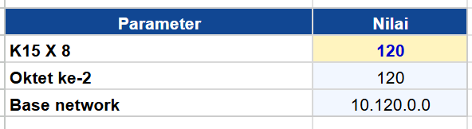
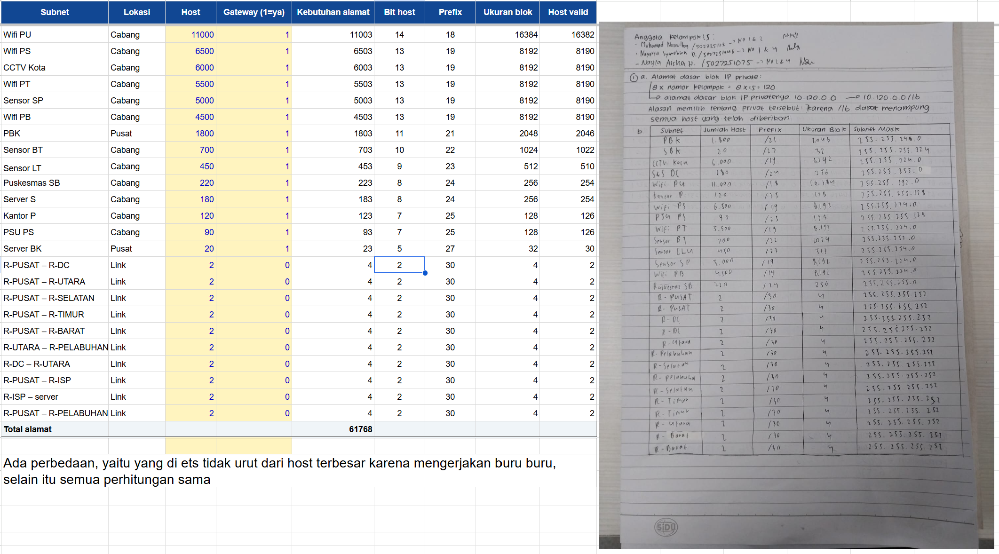
VLSM
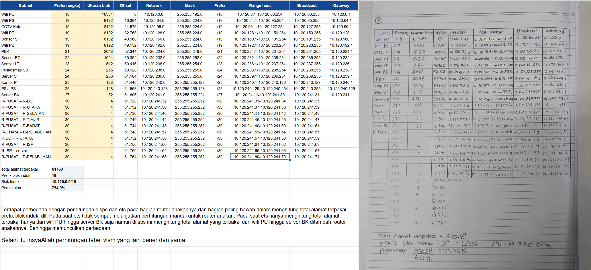
CIDR
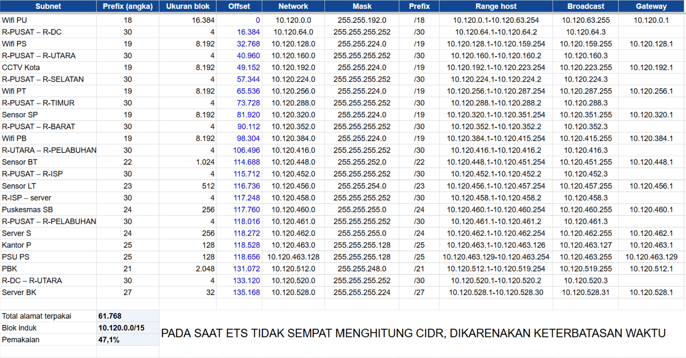
SUPERNET
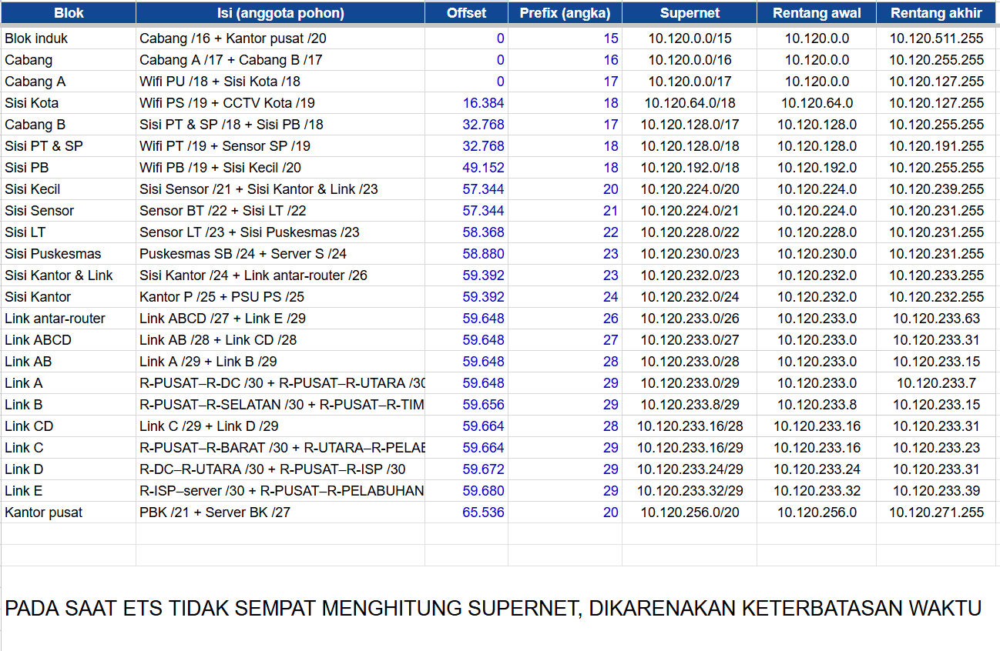


---

## 3. Penjelasan Konfigurasi Jaringan (Soal 3 – Soal 8)

### 3.1 Soal 3: Static Routing

#### A. Konsep dan Aturan Konfigurasi Static Routing
Agar seluruh LAN di semua wilayah dapat saling berkomunikasi tanpa protokol *dynamic routing*, kami menerapkan skema **Static Routing berjenjang (Hierarkis)** sesuai ketentuan soal:
1. **Aturan *Default Route* (`0.0.0.0 0.0.0.0`):** *Default route* hanya dikonfigurasi mengarah ke router di atasnya (*upstream* / ke arah luar). 
   * Router ujung (`R-DC`, `R-BARAT`, `R-TIMUR`, `R-SELATAN`) mengarahkan *default route* ke `R-PUSAT`.
   * `R-PELABUHAN` mengarahkan *default route* ke `R-UTARA` (`10.120.241.53`).
   * `R-UTARA` mengarahkan *default route* ke `R-PUSAT` (`10.120.241.37`).
   * `R-PUSAT` mengarahkan *default route* keluar menuju `R-ISP` (`203.0.113.62`).
2. **Aturan *Static Route* Spesifik (Arah ke Dalam / *Downstream*):**
   * **`R-PUSAT`** memiliki 12 baris *static route* spesifik yang memetakan seluruh subnet LAN di bawah kendali `R-DC`, `R-UTARA`, `R-PELABUHAN` (diteruskan lewat *next-hop* `R-UTARA`), `R-SELATAN`, `R-TIMUR`, dan `R-BARAT`.
   * **`R-UTARA`** memiliki 2 baris *static route* spesifik untuk meneruskan paket yang menuju jaringan di bawahnya, yaitu LAN Sensor & SCADA Pelabuhan (`10.120.160.0/19`) dan LAN Kantor Pelabuhan (`10.120.240.0/25`) melalui *next-hop* `R-PELABUHAN` (`10.120.241.54`).

#### B. Rincian Konfigurasi Interface & Static Routing per Router

##### 1) Router Pusat (`R-PUSAT`)
```text
enable                                              ! Masuk ke Privileged EXEC Mode
configure terminal                                  ! Masuk ke Global Configuration Mode
hostname R-PUSAT                                    ! Mengubah nama identitas router menjadi R-PUSAT
no ip domain-lookup                                 ! Mencegah router melakukan pencarian DNS saat salah ketik perintah

! --- Konfigurasi Interface ---
interface FastEthernet 0/0
 description ke R-ISP
 ip address 203.0.113.61 255.255.255.252            ! IP publik point-to-point (/30) ke arah R-ISP
 no shutdown
interface FastEthernet 1/0
 description L1 ke R-DC
 ip address 10.120.241.33 255.255.255.252           ! IP point-to-point (/30) untuk link L1
 no shutdown
interface FastEthernet 2/0
 description L5 ke R-BARAT
 ip address 10.120.241.49 255.255.255.252           ! IP point-to-point (/30) untuk link L5
 no shutdown
interface FastEthernet 3/0
 description L2 ke R-UTARA
 ip address 10.120.241.37 255.255.255.252           ! IP point-to-point (/30) untuk link L2
 no shutdown
interface FastEthernet 4/0
 description L4 ke R-TIMUR
 ip address 10.120.241.45 255.255.255.252           ! IP point-to-point (/30) untuk link L4
 no shutdown
interface FastEthernet 5/0
 description L3 ke R-SELATAN
 ip address 10.120.241.41 255.255.255.252           ! IP point-to-point (/30) untuk link L3
 no shutdown
interface FastEthernet 6/0
 description LAN Server Balai Kota
 ip address 10.120.241.1 255.255.255.224            ! IP Gateway pertama (/27) untuk LAN Server Balai Kota
 no shutdown
interface FastEthernet 7/0
 description LAN Pegawai Balai Kota
 ip address 10.120.224.1 255.255.248.0              ! IP Gateway pertama (/21) untuk LAN Pegawai Balai Kota
 no shutdown
exit

! --- Konfigurasi Static Routing ---
ip route 0.0.0.0 0.0.0.0 203.0.113.62               ! Default route keluar menuju internet lewat next-hop R-ISP
ip route 10.120.96.0 255.255.224.0 10.120.241.34    ! Rute statis ke LAN CCTV Kota (/19) via next-hop R-DC
ip route 10.120.239.0 255.255.255.0 10.120.241.34   ! Rute statis ke LAN Server & Storage DC (/24) via next-hop R-DC
ip route 10.120.0.0 255.255.192.0 10.120.241.38     ! Rute statis ke LAN WiFi Publik Utara (/18) via next-hop R-UTARA
ip route 10.120.236.0 255.255.254.0 10.120.241.38   ! Rute statis ke LAN Sensor Lantas Utara (/23) via next-hop R-UTARA
ip route 10.120.64.0 255.255.224.0 10.120.241.42    ! Rute statis ke LAN WiFi Publik Selatan (/19) via next-hop R-SELATAN
ip route 10.120.240.128 255.255.255.128 10.120.241.42 ! Rute statis ke LAN PJU Pintar Selatan (/25) via next-hop R-SELATAN
ip route 10.120.128.0 255.255.224.0 10.120.241.46   ! Rute statis ke LAN WiFi Publik Timur (/19) via next-hop R-TIMUR
ip route 10.120.232.0 255.255.252.0 10.120.241.46   ! Rute statis ke LAN Sensor Banjir Timur (/22) via next-hop R-TIMUR
ip route 10.120.192.0 255.255.224.0 10.120.241.50   ! Rute statis ke LAN WiFi Publik Barat (/19) via next-hop R-BARAT
ip route 10.120.238.0 255.255.255.0 10.120.241.50   ! Rute statis ke LAN Puskesmas & Sekolah Barat (/24) via R-BARAT
ip route 10.120.160.0 255.255.224.0 10.120.241.38   ! Rute statis ke LAN Sensor & SCADA Pelabuhan (/19) via R-UTARA
ip route 10.120.240.0 255.255.255.128 10.120.241.38 ! Rute statis ke LAN Kantor Pelabuhan (/25) via next-hop R-UTARA
```

##### 2) Router Surabaya Utara (`R-UTARA`)
```text
enable
configure terminal
hostname R-UTARA
no ip domain-lookup

! --- Konfigurasi Interface ---
interface FastEthernet 0/0
 description LAN WiFi Publik Utara
 ip address 10.120.0.1 255.255.192.0                ! IP Gateway pertama (/18) untuk LAN WiFi Publik Utara
 no shutdown
interface FastEthernet 1/0
 description LAN Sensor Lalu Lintas Utara
 ip address 10.120.236.1 255.255.254.0              ! IP Gateway pertama (/23) untuk LAN Sensor Lantas Utara
 no shutdown
interface FastEthernet 2/0
 description L6 ke R-PELABUHAN
 ip address 10.120.241.53 255.255.255.252           ! IP point-to-point (/30) untuk link L6
 no shutdown
interface FastEthernet 3/0
 description L2 ke R-PUSAT
 ip address 10.120.241.38 255.255.255.252           ! IP point-to-point (/30) untuk link L2
 no shutdown
exit

! --- Konfigurasi Static Routing ---
ip route 0.0.0.0 0.0.0.0 10.120.241.37              ! Default route ke arah luar/atas menuju next-hop R-PUSAT
ip route 10.120.160.0 255.255.224.0 10.120.241.54   ! Rute statis ke dalam menuju LAN SCADA Pelabuhan (/19) via R-PELABUHAN
ip route 10.120.240.0 255.255.255.128 10.120.241.54 ! Rute statis ke dalam menuju LAN Kantor Pelabuhan (/25) via R-PELABUHAN
```

##### 3) Router Command Center (`R-DC`), `R-PELABUHAN`, `R-SELATAN`, `R-TIMUR`, `R-BARAT`, dan `R-ISP`
```text
! ==========================================
! KONFIGURASI R-DC
! ==========================================
enable
configure terminal
hostname R-DC
no ip domain-lookup
interface FastEthernet 0/0
 description L1 ke R-PUSAT
 ip address 10.120.241.34 255.255.255.252
 no shutdown
interface FastEthernet 1/0
 description LAN CCTV Kota
 ip address 10.120.96.1 255.255.224.0
 no shutdown
interface FastEthernet 2/0
 description LAN Server dan Storage DC
 ip address 10.120.239.1 255.255.255.0
 no shutdown
exit
ip route 0.0.0.0 0.0.0.0 10.120.241.33              ! Default route satu pintu menuju R-PUSAT

! ==========================================
! KONFIGURASI R-PELABUHAN
! ==========================================
enable
configure terminal
hostname R-PELABUHAN
no ip domain-lookup
interface FastEthernet 0/0
 description L6 ke R-UTARA
 ip address 10.120.241.54 255.255.255.252
 no shutdown
interface FastEthernet 1/0
 description LAN Sensor dan SCADA Pelabuhan
 ip address 10.120.160.1 255.255.224.0
 no shutdown
interface FastEthernet 2/0
 description LAN Kantor Pelabuhan
 ip address 10.120.240.1 255.255.255.128
 no shutdown
exit
ip route 0.0.0.0 0.0.0.0 10.120.241.53              ! Default route satu pintu menuju R-UTARA

! ==========================================
! KONFIGURASI R-SELATAN
! ==========================================
enable
configure terminal
hostname R-SELATAN
no ip domain-lookup
interface FastEthernet 0/0
 description L3 ke R-PUSAT
 ip address 10.120.241.42 255.255.255.252
 no shutdown
interface FastEthernet 1/0
 description LAN WiFi Publik Selatan
 ip address 10.120.64.1 255.255.224.0
 no shutdown
interface FastEthernet 2/0
 description LAN PJU Pintar Selatan
 ip address 10.120.240.129 255.255.255.128
 no shutdown
exit
ip route 0.0.0.0 0.0.0.0 10.120.241.41              ! Default route satu pintu menuju R-PUSAT

! ==========================================
! KONFIGURASI R-TIMUR
! ==========================================
enable
configure terminal
hostname R-TIMUR
no ip domain-lookup
interface FastEthernet 0/0
 description L4 ke R-PUSAT
 ip address 10.120.241.46 255.255.255.252
 no shutdown
interface FastEthernet 1/0
 description LAN WiFi Publik Timur
 ip address 10.120.128.1 255.255.224.0
 no shutdown
interface FastEthernet 2/0
 description LAN Sensor Banjir Timur
 ip address 10.120.232.1 255.255.252.0
 no shutdown
exit
ip route 0.0.0.0 0.0.0.0 10.120.241.45              ! Default route satu pintu menuju R-PUSAT

! ==========================================
! KONFIGURASI R-BARAT
! ==========================================
enable
configure terminal
hostname R-BARAT
no ip domain-lookup
interface FastEthernet 0/0
 description L5 ke R-PUSAT
 ip address 10.120.241.50 255.255.255.252
 no shutdown
interface FastEthernet 1/0
 description LAN WiFi Publik Barat
 ip address 10.120.192.1 255.255.224.0
 no shutdown
interface FastEthernet 2/0
 description LAN Puskesmas dan Sekolah Barat
 ip address 10.120.238.1 255.255.255.0
 no shutdown
exit
ip route 0.0.0.0 0.0.0.0 10.120.241.49              ! Default route satu pintu menuju R-PUSAT

! ==========================================
! KONFIGURASI R-ISP
! ==========================================
enable
configure terminal
hostname R-ISP
interface FastEthernet 0/0
 description ke R-PUSAT
 ip address 203.0.113.62 255.255.255.252
 no shutdown
interface FastEthernet 1/0
 description ke server internet
 ip address 8.8.8.1 255.255.255.0
 no shutdown
exit
write memory
```

---

### 3.2 Soal 4: Layanan DHCP Server & DHCP Relay

#### A. Konsep dan Strategi Pengalamatan Dinamis (DHCP)
1. **Pengaturan IP Statis untuk Perangkat Infrastruktur:** Seluruh *interface* router dan ketiga server (`Server dan storage DC`, `Server Balai Kota`, dan `Server 8.8.8.8`) dikonfigurasi secara manual (*Static*) agar alamat *gateway* dan alamat penyedia layanan aplikasi (DNS, Web, FTP, DHCP) bersifat permanen dan tidak berubah.
2. **Pencegahan Konflik IP dengan `ip dhcp excluded-address`:** Pada setiap subnet LAN yang dilayani oleh DHCP router, kami mengecualikan **10 alamat IP pertama** (misalnya `.1` s/d `.10`, atau `.129` s/d `.138` pada PJU Pintar Selatan). Hal ini wajib dilakukan karena:
   * Mencegah *IP Conflict* (tabrakan alamat IP) antara klien DHCP dengan alamat *Default Gateway* milik router (`.1`).
   * Menyediakan ruang alamat IP cadangan (*reserved IP*) apabila di kemudian hari dipasang perangkat infrastruktur tambahan yang membutuhkan IP statis (seperti *Access Point* atau *Managed Switch*).
   * Oleh karena itu, setiap perangkat PC klien yang meminta IP via DHCP akan mendapatkan alokasi mulai dari alamat IP ke-11 (contoh: `.11` atau `.139`).
3. **Implementasi *DHCP Relay Agent* (`ip helper-address`) untuk CCTV Kota:** Sesuai instruksi khusus pada Soal 4, subnet **CCTV Kota** (`10.120.96.0/19`) di `R-DC` tidak dilayani oleh DHCP dari router, melainkan oleh **Server dan Storage DC (`10.120.239.2`)**. Karena paket *DHCP Discover* dari klien bersifat *broadcast* dan secara alami tidak dapat melewati router menuju subnet yang berbeda, kami memasang perintah `ip helper-address 10.120.239.2` pada `interface FastEthernet 1/0` di `R-DC`. Fitur ini membungkus dan meneruskan permintaan DHCP secara *unicast* menuju Server DC.

#### B. Rincian Konfigurasi IP Statis Server
Pada menu **Desktop -> IP Configuration** di masing-masing server:
* **Server dan Storage DC (`SRV-DC`):**
  * IPv4 Address: `10.120.239.2` | Subnet Mask: `255.255.255.0` | Default Gateway: `10.120.239.1` | DNS Server: `10.120.239.2`
* **Server Balai Kota (`SRV-BALAIKOTA`):**
  * IPv4 Address: `10.120.241.2` | Subnet Mask: `255.255.255.224` | Default Gateway: `10.120.241.1` | DNS Server: `10.120.239.2`
* **Server Internet (`Server 8.8.8.8`):**
  * IPv4 Address: `8.8.8.8` | Subnet Mask: `255.255.255.0` | Default Gateway: `8.8.8.1` | DNS Server: `-`

#### C. Rincian Konfigurasi DHCP Server & Relay pada Router
```text
! --- 1. DHCP Server pada R-PUSAT ---
ip dhcp excluded-address 10.120.224.1 10.120.224.10 ! Mencadangkan 10 IP awal LAN Pegawai Balai Kota
ip dhcp pool PEGAWAI-BALAIKOTA
 network 10.120.224.0 255.255.248.0
 default-router 10.120.224.1
 dns-server 10.120.239.2
exit
write memory

! --- 2. DHCP Server pada R-UTARA ---
ip dhcp excluded-address 10.120.0.1 10.120.0.10     ! Mencadangkan 10 IP awal LAN WiFi Utara
ip dhcp excluded-address 10.120.236.1 10.120.236.10 ! Mencadangkan 10 IP awal LAN Sensor Lantas Utara
ip dhcp pool WIFI-UTARA
 network 10.120.0.0 255.255.192.0
 default-router 10.120.0.1
 dns-server 10.120.239.2
ip dhcp pool SENSOR-LANTAS-UTARA
 network 10.120.236.0 255.255.254.0
 default-router 10.120.236.1
 dns-server 10.120.239.2
exit
write memory

! --- 3. DHCP Relay Agent pada R-DC (Khusus LAN CCTV Kota) ---
interface FastEthernet 1/0
 description LAN CCTV Kota
 ip helper-address 10.120.239.2                     ! Meneruskan paket DHCP Broadcast dari CCTV ke SRV-DC
exit
write memory

! --- 4. DHCP Server pada R-PELABUHAN ---
ip dhcp excluded-address 10.120.160.1 10.120.160.10
ip dhcp excluded-address 10.120.240.1 10.120.240.10
ip dhcp pool SCADA-PELABUHAN
 network 10.120.160.0 255.255.224.0
 default-router 10.120.160.1
 dns-server 10.120.239.2
ip dhcp pool KANTOR-PELABUHAN
 network 10.120.240.0 255.255.255.128
 default-router 10.120.240.1
 dns-server 10.120.239.2
exit
write memory

! --- 5. DHCP Server pada R-SELATAN ---
ip dhcp excluded-address 10.120.64.1 10.120.64.10
ip dhcp excluded-address 10.120.240.129 10.120.240.138
ip dhcp pool WIFI-SELATAN
 network 10.120.64.0 255.255.224.0
 default-router 10.120.64.1
 dns-server 10.120.239.2
ip dhcp pool PJU-SELATAN
 network 10.120.240.128 255.255.255.128
 default-router 10.120.240.129
 dns-server 10.120.239.2
exit
write memory

! --- 6. DHCP Server pada R-TIMUR ---
ip dhcp excluded-address 10.120.128.1 10.120.128.10
ip dhcp excluded-address 10.120.232.1 10.120.232.10
ip dhcp pool WIFI-TIMUR
 network 10.120.128.0 255.255.224.0
 default-router 10.120.128.1
 dns-server 10.120.239.2
ip dhcp pool SENSOR-BANJIR-TIMUR
 network 10.120.232.0 255.255.252.0
 default-router 10.120.232.1
 dns-server 10.120.239.2
exit
write memory

! --- 7. DHCP Server pada R-BARAT ---
ip dhcp excluded-address 10.120.192.1 10.120.192.10
ip dhcp excluded-address 10.120.238.1 10.120.238.10
ip dhcp pool WIFI-BARAT
 network 10.120.192.0 255.255.224.0
 default-router 10.120.192.1
 dns-server 10.120.239.2
ip dhcp pool PUSKESMAS-BARAT
 network 10.120.238.0 255.255.255.0
 default-router 10.120.238.1
 dns-server 10.120.239.2
exit
write memory
```

---

### 3.3 Soal 5: Network Address Translation (NAT)

#### A. Konsep dan Alasan Konfigurasi
Soal 5 meminta seluruh *host* dapat mengakses `Server 8.8.8.8` dengan memakai **satu IP publik milik `R-PUSAT`**, sedangkan `R-ISP` **tidak boleh** memiliki rute ke alamat privat internal. Kami menggunakan **NAT Overload (PAT)** di `R-PUSAT`:

1. **Mengapa NAT diperlukan:** Alamat `10.120.x.x` adalah alamat privat yang tidak dapat dirutekan di internet. Karena itu, `R-PUSAT` mengganti alamat asal paket (misalnya `10.120.96.10`) menjadi satu alamat publik, yaitu `203.0.113.61` (IP `FastEthernet0/0` milik `R-PUSAT` pada link ke `R-ISP`).
2. **Mengapa `overload` (PAT):** Banyak *host* dapat memakai satu IP publik karena `R-PUSAT` membedakan setiap sesi dengan nomor *port*. Saat balasan datang, `R-PUSAT` mengembalikan alamat tujuan ke IP privat *host* asal.
3. **Mengapa interface harus ditandai *inside* dan *outside*:** NAT harus tahu arah lalu lintas. Interface *inside* menghadap jaringan internal, interface *outside* menghadap internet. NAT hanya bekerja pada paket yang melintas di antara keduanya. Lalu lintas antar-wilayah internal tidak ikut diterjemahkan karena tidak melewati batas tersebut. `Tunnel0` tidak ditandai *inside* karena hanya dipakai lalu lintas internal Balai Kota dan Pelabuhan, bukan menuju internet.
4. **Mengapa `R-ISP` tidak butuh rute ke alamat privat:** Setiap paket yang sampai ke `R-ISP` sudah bersumber `203.0.113.61` (jaringan yang terhubung langsung), sehingga balasannya cukup dikirim kembali ke alamat itu. Selama `R-ISP` hanya memiliki dua rute *connected* (`8.8.8.0/24` dan `203.0.113.60/30`) tanpa *static route* dan tanpa *routing* dinamis, syarat soal terpenuhi.


#### B. Penentuan Interface NAT pada `R-PUSAT`

| Interface | Fungsi | Peran NAT |
| :--- | :--- | :--- |
| `FastEthernet0/0` | Link ke `R-ISP` (`203.0.113.61/30`) | `outside` |
| `FastEthernet0/1` | L2 ke `R-UTARA` | `inside` |
| `Ethernet0/0/0` | L1 ke `R-DC` | `inside` |
| `Ethernet0/1/0` | L5 ke `R-BARAT` | `inside` |
| `Ethernet0/2/0` | L4 ke `R-TIMUR` | `inside` |
| `Ethernet0/3/0` | L3 ke `R-SELATAN` | `inside` |
| `FastEthernet1/0` | LAN Pegawai Balai Kota | `inside` |
| `FastEthernet1/1` | LAN Server Balai Kota | `inside` |

#### C. Rincian Konfigurasi NAT pada `R-PUSAT`
```text
enable
configure terminal

! --- Menandai interface outside (arah R-ISP) ---
interface FastEthernet0/0
 ip nat outside                                      ! Sisi internet
 exit

! --- Menandai interface inside (arah jaringan internal) ---
interface FastEthernet0/1
 ip nat inside                                       ! L2 ke R-UTARA
 exit
interface Ethernet0/0/0
 ip nat inside                                       ! L1 ke R-DC
 exit
interface Ethernet0/1/0
 ip nat inside                                       ! L5 ke R-BARAT
 exit
interface Ethernet0/2/0
 ip nat inside                                       ! L4 ke R-TIMUR
 exit
interface Ethernet0/3/0
 ip nat inside                                       ! L3 ke R-SELATAN
 exit
interface FastEthernet1/0
 ip nat inside                                       ! LAN Pegawai Balai Kota
 exit
interface FastEthernet1/1
 ip nat inside                                       ! LAN Server Balai Kota
 exit

! --- Daftar alamat yang boleh di-NAT dan aturan overload ---
access-list 1 permit 10.120.0.0 0.0.255.255          ! Seluruh blok privat 10.120.0.0/16 (semua LAN)
ip nat inside source list 1 interface FastEthernet0/0 overload  ! Terjemahkan ke IP Fa0/0 (203.0.113.61), banyak host satu IP (PAT)
end
write memory
```
`R-ISP` tidak diberi konfigurasi tambahan terkait NAT dan tidak memiliki *static route* ke blok privat.

---

### 3.4 Soal 6: Tunnel GRE

#### Konfigurasi Tambahan Tunnel GRE

Konfigurasi di bawah ini **hanya tambahan untuk Soal 6**, ditambahkan di atas konfigurasi Soal 3 & 4 yang sudah ada.

#### R-PUSAT

```text
enable
configure terminal

! --- Interface Tunnel GRE ---
interface Tunnel0
 description GRE ke R-PELABUHAN
 ip address 192.168.15.1 255.255.255.252
 tunnel source FastEthernet0/1
 tunnel destination 10.120.241.54
 tunnel mode gre ip
 no shutdown
 exit

! --- Rute ke IP fisik R-PELABUHAN (link L6) ---
! Wajib ada: default route R-PUSAT mengarah ke R-ISP, jadi tanpa rute ini
! tunnel destination 10.120.241.54 tidak bisa dijangkau.
ip route 10.120.241.52 255.255.255.252 10.120.241.38

! --- Rute utama ke subnet Pelabuhan lewat tunnel (AD = 1) ---
ip route 10.120.160.0 255.255.224.0 192.168.15.2
ip route 10.120.240.0 255.255.255.128 192.168.15.2

! --- Rute cadangan lewat R-UTARA (floating static, AD = 5) ---
ip route 10.120.160.0 255.255.224.0 10.120.241.38 5
ip route 10.120.240.0 255.255.255.128 10.120.241.38 5

end
write memory
```

#### R-PELABUHAN

```text
enable
configure terminal

! --- Interface Tunnel GRE ---
interface Tunnel0
 description GRE ke R-PUSAT
 ip address 192.168.15.2 255.255.255.252
 tunnel source GigabitEthernet0/0
 tunnel destination 10.120.241.37
 tunnel mode gre ip
 no shutdown
 exit

! --- Rute ke IP fisik R-PUSAT (link L2) ---
ip route 10.120.241.36 255.255.255.252 10.120.241.53

! --- Rute ke subnet Balai Kota lewat tunnel ---
ip route 10.120.224.0 255.255.248.0 192.168.15.1
ip route 10.120.241.0 255.255.255.224 192.168.15.1

end
write memory
```

#### Uji dari PC (bukti lalu lintas lewat tunnel)

Cek dulu IP PC tujuan lewat **Desktop → IP Configuration**, karena IP dari DHCP bisa berbeda.

Dari **PC Pegawai Balai Kota** → **Desktop → Command Prompt**:

```text
tracert <IP PC Kantor Pelabuhan>
```

**Hasil yang benar:**


#### Mengapa router memilih jalur tunnel dibanding jalur lain ke Pelabuhan?

- **Di R-PUSAT:** ada dua rute ke subnet Pelabuhan dengan prefix yang sama. Rute lewat tunnel (`via 192.168.15.2`) memakai **Administrative Distance 1**, sedangkan rute lewat R-UTARA (`via 10.120.241.38`) memakai **AD 5** (*floating static route*). Router selalu memasang rute dengan AD terkecil ke tabel routing, jadi jalur tunnel menjadi jalur utama. Rute lewat R-UTARA hanya dipakai sebagai cadangan kalau rute tunnel hilang.
- **Di R-PELABUHAN:** jalur lain menuju Balai Kota hanya lewat *default route* `0.0.0.0/0 via 10.120.241.53`. Rute lewat tunnel memakai prefix yang jauh lebih spesifik (`/21` dan `/27`). Berdasarkan aturan **Longest Prefix Match**, router selalu memilih rute dengan prefix paling panjang, jadi lalu lintas ke Balai Kota masuk ke tunnel.

#### Mengapa GRE saja tidak mengenkripsi data?

GRE (*Generic Routing Encapsulation*, RFC 2784) adalah protokol **enkapsulasi**, bukan protokol keamanan. Tugasnya hanya membungkus paket asli dengan header GRE dan header IP baru, supaya paket bisa dikirim lewat jalur virtual *point-to-point*. GRE **tidak punya mekanisme kriptografi**: tidak ada enkripsi, tidak ada pengecekan integritas, dan tidak ada autentikasi. Akibatnya, isi paket di dalam tunnel tetap *plaintext* dan bisa dibaca oleh siapa pun yang menyadap jalur di tengah (misalnya di R-UTARA). Ini terlihat di Simulation Mode: header ICMP dan IP dalam tetap terbaca utuh. Untuk mengenkripsi data, GRE harus dikombinasikan dengan **IPsec** (GRE over IPsec).


---

### 3.5 Soal 7: Dynamic Routing OSPF


#### A. Konsep dan Alasan Konfigurasi

| Ketentuan soal | Cara kami memenuhinya |
| :--- | :--- |
| Tambah link cadangan L7 antara `R-DC` dan `R-UTARA` dengan alamat yang belum dipakai | Memakai `10.120.241.56/30`: `R-DC` `.57` (`Fa3/0`) dan `R-UTARA` `.58` (`Fa4/0`) |
| Ganti seluruh *static route* antar-router dengan OSPF | OSPF *process* 1, *area* 0, pada 7 router. Seluruh *static route* antar-router dihapus |
| Router tidak mengirim pesan OSPF ke arah LAN pengguna | `passive-interface default`, lalu `no passive-interface` hanya pada link antar-router |
| *Default route* hanya di `R-PUSAT`, router lain mendapatkannya otomatis | Satu-satunya *static route* yang tersisa adalah *default* ke `R-ISP` di `R-PUSAT`, dibagikan dengan `default-information originate` |
| Jika satu link *backbone* putus, konektivitas pulih otomatis | Diuji dengan mematikan link L1 dan L2 |

Arti perintah utama yang dipakai:

| Perintah | Arti |
| :--- | :--- |
| `router ospf 1` dan `area 0` | Menyalakan OSPF. Semua router berada dalam satu *area backbone* karena jaringan tidak besar |
| `router-id` | Identitas unik tiap router di OSPF (`1.1.1.1` sampai `7.7.7.7`) |
| `network <alamat> <wildcard> area 0` | Menentukan interface yang ikut OSPF dan jaringan yang diumumkan: link `/30` antar-router dan seluruh LAN |
| `passive-interface default` | Semua interface secara bawaan tidak mengirim pesan OSPF |
| `no passive-interface <interface link>` | Mengaktifkan OSPF hanya pada link antar-router agar router dapat bertukar informasi |
| `default-information originate` (hanya `R-PUSAT`) | `R-PUSAT` membagikan jalan menuju internet ke router lain |

LAN pengguna tetap diumumkan lewat `network`, tetapi karena *passive*, tidak ada pesan OSPF yang dikirim ke perangkat di LAN tersebut. Interface `Fa0/0` `R-PUSAT` (arah `R-ISP`) tidak memiliki `network` dan juga *passive*, sehingga tidak ada OSPF ke arah ISP.


#### B. Penambahan Link Cadangan L7 (`R-DC` ke `R-UTARA`)
Blok `10.120.241.56/30` sudah dialokasikan untuk L7 pada tabel VLSM dan belum dipakai link lain, sehingga tabel subnetting tidak berubah.

| Perangkat | Interface | IP | Prefix |
| :--- | :--- | :--- | :--- |
| `R-DC` | `FastEthernet3/0` | `10.120.241.57` | `/30` |
| `R-UTARA` | `FastEthernet4/0` | `10.120.241.58` | `/30` |

Seluruh port `R-DC` (`Fa0/0` untuk L1, `Fa1/0` untuk CCTV Kota, `Fa2/0` untuk Server dan Storage DC) dan `R-UTARA` (`Fa0/0` sampai `Fa3/0`) sudah terpakai. Karena itu kami menambah satu modul `PT-ROUTER-NM-1CFE` (1 port *FastEthernet* tembaga) pada masing-masing router: router dimatikan, modul dipasang di slot kosong, lalu router dinyalakan lagi. Port baru yang muncul adalah **`Fa3/0` di `R-DC`** dan **`Fa4/0` di `R-UTARA`**, lalu keduanya dihubungkan dengan kabel *Copper Cross-Over*.

```text
! --- R-DC ---
enable
configure terminal
interface FastEthernet3/0
 description L7 ke R-UTARA
 ip address 10.120.241.57 255.255.255.252
 no shutdown
end

! --- R-UTARA ---
enable
configure terminal
interface FastEthernet4/0
 description L7 ke R-DC
 ip address 10.120.241.58 255.255.255.252
 no shutdown
end
```

#### C. Rincian Konfigurasi OSPF per Router

| Router | Router-ID | Interface link (OSPF aktif) | Interface LAN (*passive*) |
| :--- | :--- | :--- | :--- |
| `R-PUSAT` | `1.1.1.1` | `Fa0/1` (L2), `Eth0/0/0` (L1), `Eth0/1/0` (L5), `Eth0/2/0` (L4), `Eth0/3/0` (L3) | `Fa1/0`, `Fa1/1` (`Fa0/0` ke `R-ISP` juga *passive*) |
| `R-DC` | `2.2.2.2` | `Fa0/0` (L1), `Fa3/0` (L7) | `Fa1/0`, `Fa2/0` |
| `R-UTARA` | `3.3.3.3` | `Fa3/0` (L2), `Fa2/0` (L6), `Fa4/0` (L7) | `Fa0/0`, `Fa1/0` |
| `R-PELABUHAN` | `4.4.4.4` | `Gi0/0` (L6) | `Gi0/1`, `Gi0/2` |
| `R-SELATAN` | `5.5.5.5` | `Fa0/0` (L3) | `Fa1/0`, `Fa2/0` |
| `R-TIMUR` | `6.6.6.6` | `Fa0/0` (L4) | `Fa1/0`, `Fa2/0` |
| `R-BARAT` | `7.7.7.7` | `Fa0/0` (L5) | `Fa1/0`, `Fa2/0` |

```text
! ==========================================
! OSPF R-PUSAT
! ==========================================
enable
configure terminal
router ospf 1
 router-id 1.1.1.1
 passive-interface default                          ! Semua interface diam, tidak kirim pesan OSPF
 no passive-interface FastEthernet0/1               ! Buka L2 ke R-UTARA
 no passive-interface Ethernet0/0/0                 ! Buka L1 ke R-DC
 no passive-interface Ethernet0/1/0                 ! Buka L5 ke R-BARAT
 no passive-interface Ethernet0/2/0                 ! Buka L4 ke R-TIMUR
 no passive-interface Ethernet0/3/0                 ! Buka L3 ke R-SELATAN
 network 10.120.241.32 0.0.0.3 area 0               ! L1
 network 10.120.241.36 0.0.0.3 area 0               ! L2
 network 10.120.241.40 0.0.0.3 area 0               ! L3
 network 10.120.241.44 0.0.0.3 area 0               ! L4
 network 10.120.241.48 0.0.0.3 area 0               ! L5
 network 10.120.224.0 0.0.7.255 area 0              ! LAN Pegawai Balai Kota (/21)
 network 10.120.241.0 0.0.0.31 area 0               ! LAN Server Balai Kota (/27)
 default-information originate                      ! Bagikan default route ke router lain
end
write memory

! ==========================================
! OSPF R-DC
! ==========================================
enable
configure terminal
router ospf 1
 router-id 2.2.2.2
 passive-interface default
 no passive-interface FastEthernet0/0               ! L1
 no passive-interface FastEthernet3/0               ! L7
 network 10.120.241.32 0.0.0.3 area 0
 network 10.120.241.56 0.0.0.3 area 0
 network 10.120.96.0 0.0.31.255 area 0              ! LAN CCTV Kota (/19)
 network 10.120.239.0 0.0.0.255 area 0              ! LAN Server dan Storage DC (/24)
end
write memory

! ==========================================
! OSPF R-UTARA
! ==========================================
enable
configure terminal
router ospf 1
 router-id 3.3.3.3
 passive-interface default
 no passive-interface FastEthernet2/0               ! L6
 no passive-interface FastEthernet3/0               ! L2
 no passive-interface FastEthernet4/0               ! L7
 network 10.120.241.36 0.0.0.3 area 0
 network 10.120.241.52 0.0.0.3 area 0
 network 10.120.241.56 0.0.0.3 area 0
 network 10.120.0.0 0.0.63.255 area 0               ! LAN WiFi Publik Utara (/18)
 network 10.120.236.0 0.0.1.255 area 0              ! LAN Sensor Lalu Lintas Utara (/23)
end
write memory

! ==========================================
! OSPF R-PELABUHAN
! ==========================================
enable
configure terminal
router ospf 1
 router-id 4.4.4.4
 passive-interface default
 no passive-interface GigabitEthernet0/0            ! L6
 network 10.120.241.52 0.0.0.3 area 0
 network 10.120.160.0 0.0.31.255 area 0             ! LAN Sensor dan SCADA Pelabuhan (/19)
 network 10.120.240.0 0.0.0.127 area 0              ! LAN Kantor Pelabuhan (/25)
end
write memory

! ==========================================
! OSPF R-SELATAN
! ==========================================
enable
configure terminal
router ospf 1
 router-id 5.5.5.5
 passive-interface default
 no passive-interface FastEthernet0/0               ! L3
 network 10.120.241.40 0.0.0.3 area 0
 network 10.120.64.0 0.0.31.255 area 0              ! LAN WiFi Publik Selatan (/19)
 network 10.120.240.128 0.0.0.127 area 0            ! LAN PJU Pintar Selatan (/25)
end
write memory

! ==========================================
! OSPF R-TIMUR
! ==========================================
enable
configure terminal
router ospf 1
 router-id 6.6.6.6
 passive-interface default
 no passive-interface FastEthernet0/0               ! L4
 network 10.120.241.44 0.0.0.3 area 0
 network 10.120.128.0 0.0.31.255 area 0             ! LAN WiFi Publik Timur (/19)
 network 10.120.232.0 0.0.3.255 area 0              ! LAN Sensor Banjir Timur (/22)
end
write memory

! ==========================================
! OSPF R-BARAT
! ==========================================
enable
configure terminal
router ospf 1
 router-id 7.7.7.7
 passive-interface default
 no passive-interface FastEthernet0/0               ! L5
 network 10.120.241.48 0.0.0.3 area 0
 network 10.120.192.0 0.0.31.255 area 0             ! LAN WiFi Publik Barat (/19)
 network 10.120.238.0 0.0.0.255 area 0              ! LAN Puskesmas dan Sekolah Barat (/24)
end
write memory
```

#### D. Penghapusan Static Route
Router lebih mengutamakan *static route* daripada OSPF (*administrative distance* 1 melawan 110, makin kecil makin diutamakan). Selama *static route* masih ada, hasil OSPF tidak terlihat. Karena itu OSPF dipasang dan dipastikan semua tetangga berstatus `FULL` terlebih dahulu, baru *static route* dihapus. Urutan: `R-BARAT`, `R-TIMUR`, `R-SELATAN`, `R-DC`, `R-PELABUHAN`, `R-UTARA`, dan `R-PUSAT` paling akhir. Daftar *static route* dilihat dengan `show running-config | include ip route`.

| Router | *Static route* yang dihapus |
| :--- | :--- |
| `R-BARAT`, `R-TIMUR`, `R-SELATAN`, `R-DC` | *Default route* ke `R-PUSAT` |
| `R-PELABUHAN` | *Default* via `10.120.241.53`, rute `10.120.241.36/30` via `10.120.241.53`, dan dua rute ke Balai Kota (`10.120.224.0/21`, `10.120.241.0/27`) via `192.168.15.1` |
| `R-UTARA` | *Default* via `10.120.241.37` dan dua rute ke LAN Pelabuhan (`10.120.160.0/19`, `10.120.240.0/25`) via `10.120.241.54` |
| `R-PUSAT` | 15 rute: 10 rute ke LAN `R-DC`, `R-UTARA`, `R-SELATAN`, `R-TIMUR`, `R-BARAT`, rute `10.120.241.52/30`, dua rute ke LAN Pelabuhan lewat tunnel `192.168.15.2`, dan dua rute cadangan (AD 5). *Default* ke `203.0.113.62` **dipertahankan** |


```text
! --- R-BARAT ---
enable
configure terminal
no ip route 0.0.0.0 0.0.0.0 10.120.241.49
end
write memory

! --- R-TIMUR ---
enable
configure terminal
no ip route 0.0.0.0 0.0.0.0 10.120.241.45
end
write memory

! --- R-SELATAN ---
enable
configure terminal
no ip route 0.0.0.0 0.0.0.0 10.120.241.41
end
write memory

! --- R-DC ---
enable
configure terminal
no ip route 0.0.0.0 0.0.0.0 10.120.241.33
end
write memory

! --- R-PELABUHAN ---
enable
configure terminal
no ip route 0.0.0.0 0.0.0.0 10.120.241.53
no ip route 10.120.241.36 255.255.255.252 10.120.241.53
no ip route 10.120.224.0 255.255.248.0 192.168.15.1
no ip route 10.120.241.0 255.255.255.224 192.168.15.1
end
write memory

! --- R-UTARA ---
enable
configure terminal
no ip route 0.0.0.0 0.0.0.0 10.120.241.37
no ip route 10.120.160.0 255.255.224.0 10.120.241.54
no ip route 10.120.240.0 255.255.255.128 10.120.241.54
end
write memory

! --- R-PUSAT (semua dihapus kecuali default ke 203.0.113.62) ---
enable
configure terminal
no ip route 10.120.96.0 255.255.224.0 10.120.241.34
no ip route 10.120.239.0 255.255.255.0 10.120.241.34
no ip route 10.120.0.0 255.255.192.0 10.120.241.38
no ip route 10.120.236.0 255.255.254.0 10.120.241.38
no ip route 10.120.64.0 255.255.224.0 10.120.241.42
no ip route 10.120.240.128 255.255.255.128 10.120.241.42
no ip route 10.120.128.0 255.255.224.0 10.120.241.46
no ip route 10.120.232.0 255.255.252.0 10.120.241.46
no ip route 10.120.192.0 255.255.224.0 10.120.241.50
no ip route 10.120.238.0 255.255.255.0 10.120.241.50
no ip route 10.120.241.52 255.255.255.252 10.120.241.38
no ip route 10.120.160.0 255.255.224.0 192.168.15.2
no ip route 10.120.240.0 255.255.255.128 192.168.15.2
no ip route 10.120.160.0 255.255.224.0 10.120.241.38 5
no ip route 10.120.240.0 255.255.255.128 10.120.241.38 5
end
write memory
```

#### E. Catatan Desain: Tunnel GRE pada File OSPF
* `Tunnel0` (`R-PUSAT` dan `R-PELABUHAN`) **tidak dimasukkan ke OSPF**. Alasannya, alamat ujung tunnel dipelajari lewat OSPF. Jika tunnel juga ikut OSPF, router dapat mencari jalan menuju ujung tunnel melalui tunnel itu sendiri (*recursive routing*) sehingga tunnel mati.
* *Static route* soal 6 (rute Balai Kota ke Pelabuhan lewat tunnel beserta rute cadangannya) ikut dihapus sesuai ketentuan mengganti seluruh *static route* dengan OSPF. Akibatnya, pada file OSPF lalu lintas Balai Kota ke Pelabuhan tidak lagi dipaksa lewat tunnel. Ketentuan soal 6 dibuktikan pada file utama.

#### F. Penjelasan Tambahan
* Selama L1 normal, jalur `R-DC` ke `R-PUSAT` lewat L1 lebih pendek (satu link) dibanding lewat L7 dan `R-UTARA` (dua link), sehingga OSPF memilih L1 dan L7 hanya menjadi cadangan.
* *Default route* tampil sebagai `O*E2` di router lain karena berasal dari luar OSPF (*static route* di `R-PUSAT` yang dibagikan ulang), yaitu *external type 2*.
* Link antar-router berjenis Ethernet (*broadcast*), sehingga OSPF memilih satu *Designated Router* (DR) dan satu *Backup DR* (BDR) pada tiap link. Itu sebabnya status tetangga tertulis `FULL/DR` atau `FULL/BDR`.

---

### 3.6 Soal 8: Layanan Aplikasi Smart City

### Soal 8a – DNS

> **Ketentuan:** DNS di LAN Server dan Storage DC. Nama `www`, `ftp`, dan `mail` dapat diakses dari seluruh wilayah.

####  Konfigurasi

**Server dan Storage DC → Services → DNS**

1. **DNS Service: On**
2. Tambahkan record berikut (Type `A Record`, klik **Add** di setiap baris):

| Name | Type | Address | Mengarah ke |
|---|---|---|---|
| `k15.smartcity.lab` | A Record | `10.120.241.2` | Server Balai Kota |
| `www.k15.smartcity.lab` | A Record | `10.120.241.2` | Server Balai Kota (Web) |
| `ftp.k15.smartcity.lab` | A Record | `10.120.239.2` | Server dan Storage DC (FTP) |
| `mail.k15.smartcity.lab` | A Record | `10.120.241.2` | Server Balai Kota (Email) |

#### Command Pengujian

Dari PC klien → **Desktop → Command Prompt**:

```text
ping www.k15.smartcity.lab
ping ftp.k15.smartcity.lab
ping mail.k15.smartcity.lab
```

**Hasil yang benar:** setiap nama domain diterjemahkan ke IP yang sesuai dan mendapat **Reply**.

#### Hasil

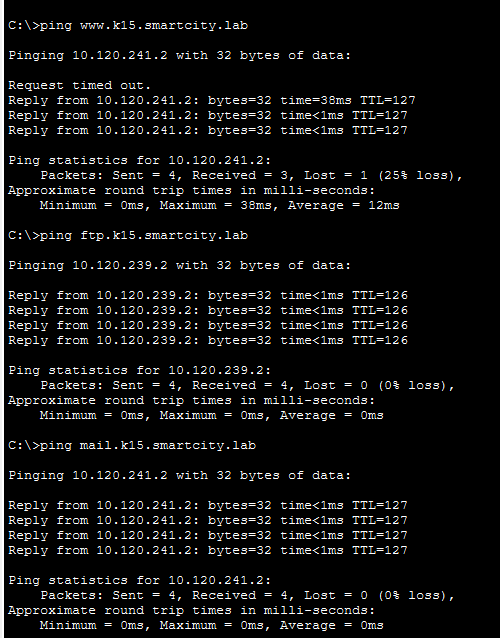

**Analisis:**

- `www.k15.smartcity.lab` → `10.120.241.2` ✅
- `ftp.k15.smartcity.lab` → `10.120.239.2` ✅
- `mail.k15.smartcity.lab` → `10.120.241.2` ✅
- Satu `Request timed out` di ping pertama itu normal. Paket pertama tertunda karena router masih mencari alamat MAC tujuan (proses ARP). Paket berikutnya semua berhasil.

---

#### – Soal 8b Web Portal

> **Ketentuan:** Web di LAN Server Balai Kota, berupa halaman "Portal Smart City Surabaya" yang mencantumkan nomor kelompok, dan dapat dibuka dengan nama domain dari semua wilayah.

#### Konfigurasi

**Server Balai Kota → Services → HTTP**

1. **HTTP: On** dan **HTTPS: On**
2. Edit file **`index.html`**, ganti isinya dengan:

```html
<html>
<head>
  <title>Portal Smart City Surabaya</title>
</head>
<body style="font-family: Arial, sans-serif; text-align: center; margin-top: 40px;">
  <h1 style="color: #0056b3;">Portal Smart City Surabaya</h1>
  <h2>Kelompok 15</h2>
  <hr>
  <p>Selamat datang di Portal Resmi Layanan Terpadu Smart City Pemerintah Kota Surabaya.</p>
  <p>Domain Internal: <b>www.k15.smartcity.lab</b></p>
</body>
</html>
```

3. Klik **Save**, lalu **Yes** untuk menimpa file lama.

#### Command Pengujian

Dari PC di wilayah mana saja → **Desktop → Web Browser**, isi URL:

```text
http://www.k15.smartcity.lab
```

Lalu klik **Go**.

#### Hasil


**Analisis:** halaman dibuka dari **PJU Pintar Selatan** (LAN di bawah R-SELATAN), yaitu wilayah yang berbeda dari lokasi server. Halaman tampil lengkap dengan judul **"Portal Smart City Surabaya"** dan **"Kelompok 15"**, dan diakses memakai nama domain, bukan IP. ✅

---

### Soal 8c – FTP Rekaman CCTV

> **Ketentuan:** FTP di LAN Server dan Storage DC sebagai penyimpanan rekaman CCTV, dengan akun login. Perangkat di LAN CCTV Kota dapat mengunggah file ke sana.

#### Konfigurasi

**Server dan Storage DC → Services → FTP**

1. **FTP Service: On**
2. Tambahkan akun di **User Setup**, lalu klik **Add**:

| Username | Password | Permission |
|---|---|---|
| `cctv` | `cctv123` | Write, Read, Delete, Rename, List |

#### Command Pengujian

**Langkah 1, buat file rekaman** di **PC CCTV Kota → Desktop → Text Editor**. Isi teks bebas, lalu simpan dengan nama `cctv.txt`.

**Langkah 2, unggah file** lewat **PC CCTV Kota → Desktop → Command Prompt**:

```text
ftp ftp.k15.smartcity.lab
```

Saat diminta login:

```text
Username: cctv
Password: cctv123
```

Setelah muncul `ftp>`:

```text
put cctv.txt
dir
quit
```

**Hasil yang benar:** muncul `230- Logged in`, lalu `Transfer complete`, dan `cctv.txt` ada di daftar `dir`.

#### Hasil

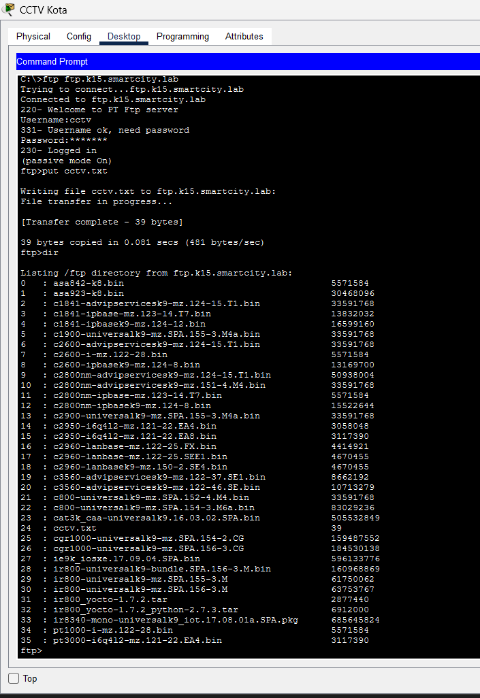


**Analisis:**

- Koneksi ke `ftp.k15.smartcity.lab` berhasil memakai nama domain (DNS 8a bekerja). ✅
- Login dengan akun `cctv` berhasil: `230- Logged in`. ✅
- Upload `cctv.txt` berhasil: `Transfer complete - 39 bytes`. ✅
- Perintah `dir` menampilkan `cctv.txt` (nomor 24, 39 byte) di direktori FTP server. ✅
- PC CCTV Kota memakai IP DHCP `10.120.96.10` dari DHCP server di LAN Server dan Storage DC (Soal 4).

---

### Soal 8d – Email Antarpegawai

> **Ketentuan:** Pengguna di Balai Kota dan Pelabuhan dapat saling mengirim dan menerima email.

#### Konfigurasi Server

**Server Balai Kota → Services → EMAIL**

1. **SMTP Service: On** dan **POP3 Service: On**
2. **Domain Name:** `k15.smartcity.lab`, lalu klik **Set**
3. Tambahkan akun (klik **+** setiap akun):

| User | Password | Alamat Email |
|---|---|---|
| `balaikota` | `12345` | `balaikota@k15.smartcity.lab` |
| `pelabuhan` | `12345` | `pelabuhan@k15.smartcity.lab` |

#### Konfigurasi Klien

**Desktop → Email → Configure Mail**, lalu klik **Save**:

| Field | PC Pegawai Balai Kota | PC Kantor Pelabuhan |
|---|---|---|
| Your Name | `Pegawai Balai Kota` | `Pegawai Pelabuhan` |
| Email Address | `balaikota@k15.smartcity.lab` | `pelabuhan@k15.smartcity.lab` |
| Incoming Mail Server | `mail.k15.smartcity.lab` | `mail.k15.smartcity.lab` |
| Outgoing Mail Server | `mail.k15.smartcity.lab` | `mail.k15.smartcity.lab` |
| Username | `balaikota` | `pelabuhan` |
| Password | `12345` | `12345` |

#### Langkah Pengujian

1. **PC Pegawai Balai Kota → Email → Compose**
   - To: `pelabuhan@k15.smartcity.lab`
   - Subject: `Ngetes rek`
   - Isi: `tes tes 1 2 3`
   - Klik **Send**
2. **PC Kantor Pelabuhan → Email → Receive**, lalu buka pesan yang masuk.
3. Klik **Reply**, isi `halo , pesan masuk rek`, lalu klik **Send**.
4. **PC Pegawai Balai Kota → Email → Receive**, lalu buka balasannya.

#### Hasil

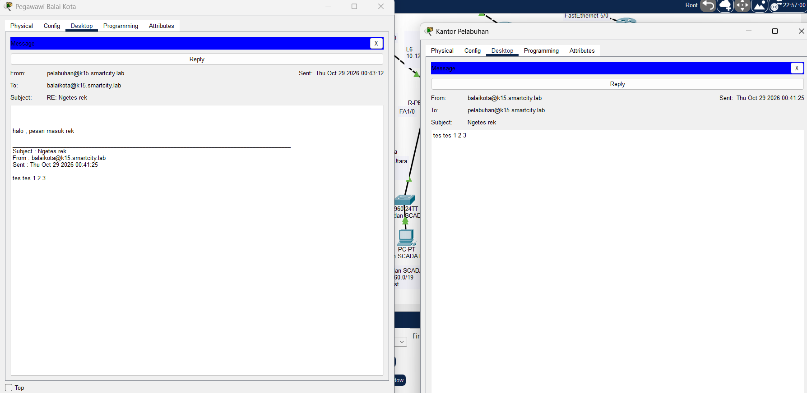

**Analisis:**

- **Kanan (Kantor Pelabuhan):** email dari `balaikota@k15.smartcity.lab` ke `pelabuhan@k15.smartcity.lab` dengan subject *"Ngetes rek"* berhasil diterima. ✅
- **Kiri (Pegawai Balai Kota):** balasan *"RE: Ngetes rek"* dari `pelabuhan@k15.smartcity.lab` berhasil diterima. ✅
- Email berhasil dikirim dan diterima **dua arah**. Lalu lintas email dari Kantor Pelabuhan ke Server Balai Kota (`10.120.241.0/27`) melewati **Tunnel GRE** dari Soal 6.


---

## 4. Bukti Pengujian Mandiri (Screenshots)

### 4.1 Bukti Pengujian Soal 1 (Perancangan Topologi)
* **Tampilan Topologi & Pelabelan Subnet:**
  

---

### 4.2 Bukti Pengujian Soal 2 (Tabel Subnetting)
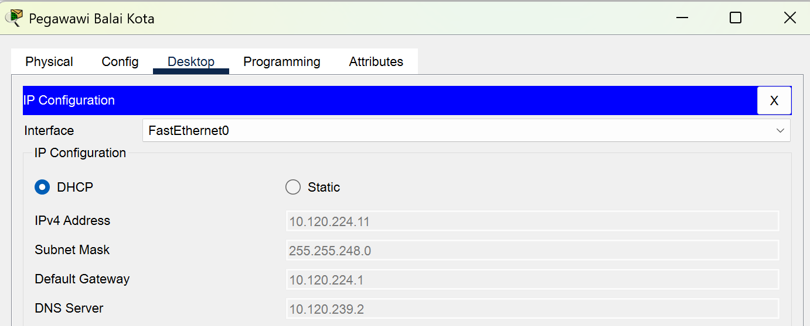
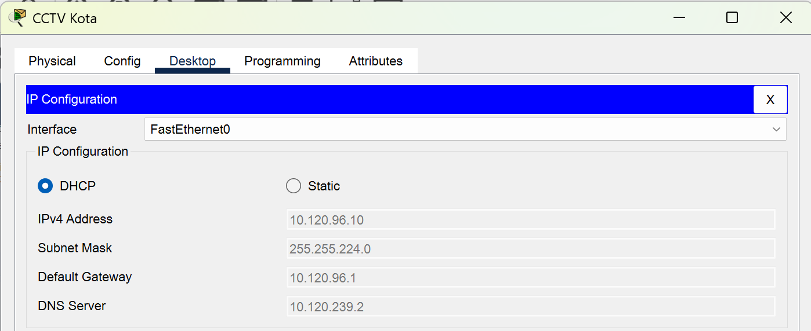
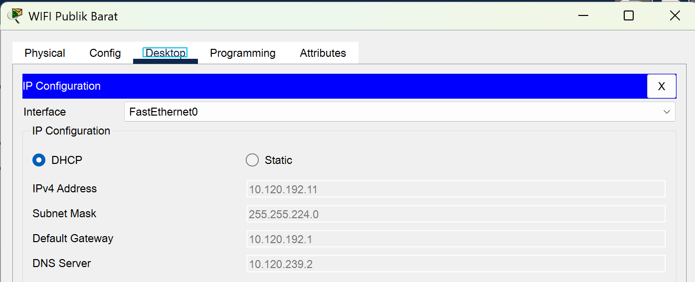
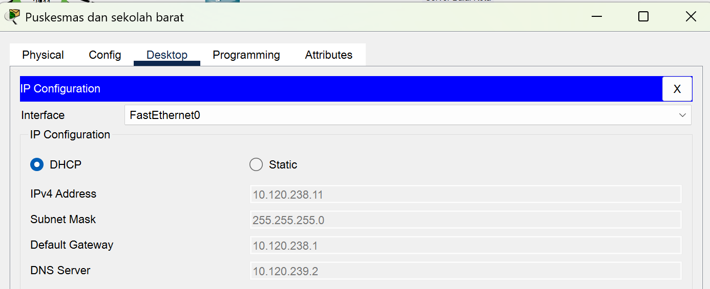
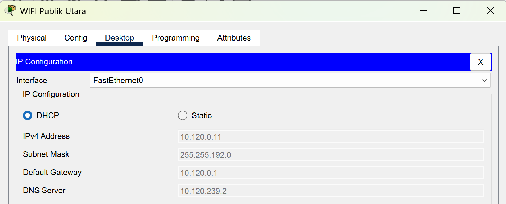

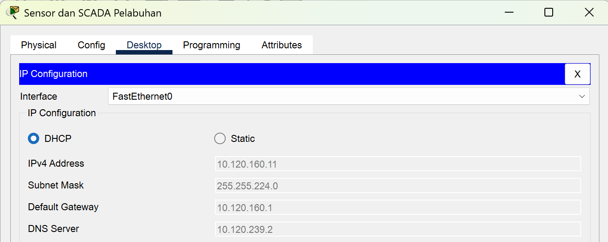
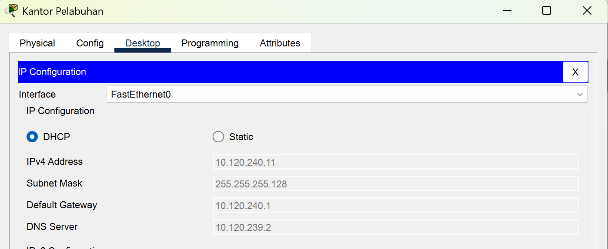
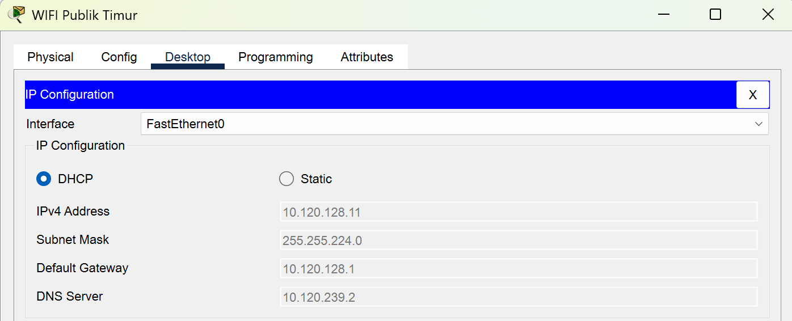
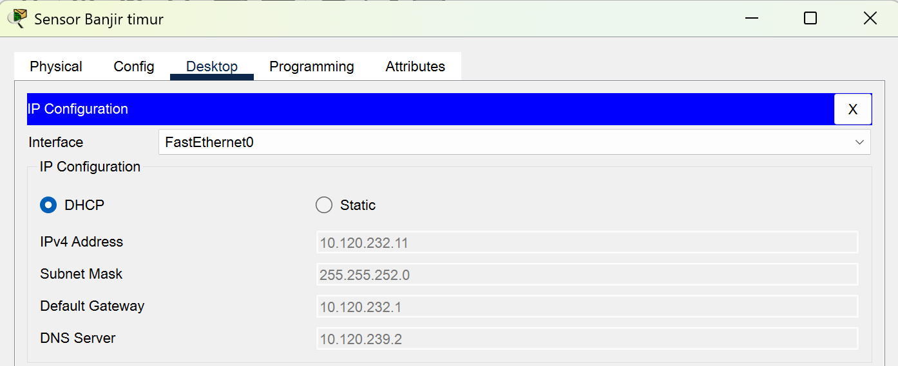
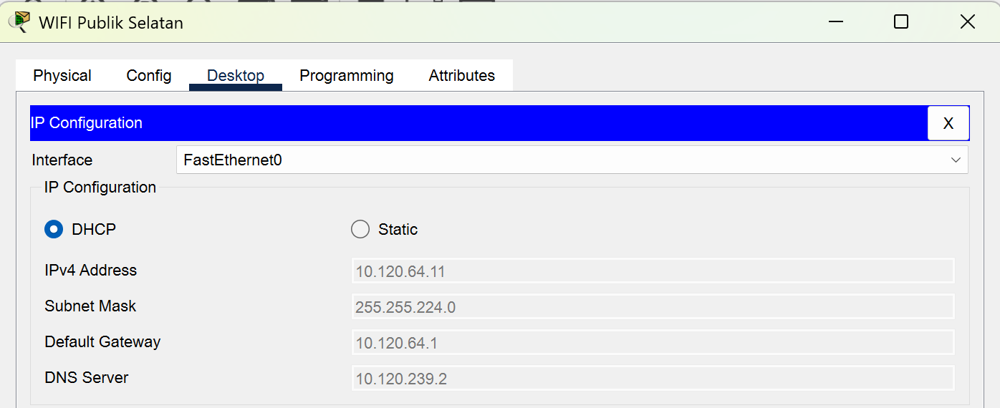
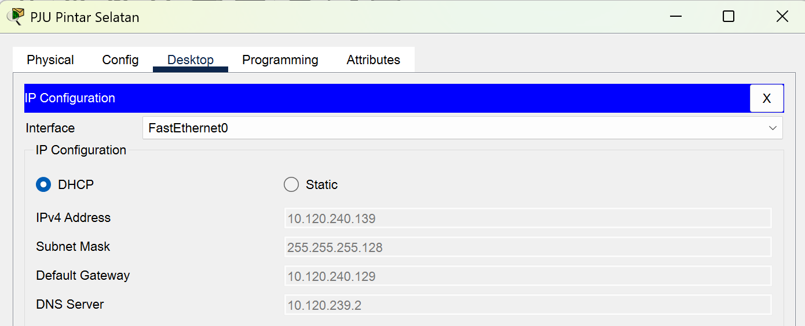

dst


---

### 4.3 Bukti Pengujian Soal 3 (Static Routing)

1. **Verifikasi Tabel Static Routing pada `R-PUSAT` (`show ip route static`):**  
   Membuktikan bahwa `R-PUSAT` telah memiliki 1 *default route* (`S* 0.0.0.0/0` via `203.0.113.62`) dan 12 rute statis spesifik (`S`) menuju seluruh subnet LAN di bawahnya.
   

2. **Verifikasi Tabel Static Routing pada `R-UTARA` (`show ip route static`):**  
   Membuktikan bahwa `R-UTARA` telah memiliki 1 *default route* ke arah `R-PUSAT` (`10.120.241.37`) serta 2 rute statis spesifik ke arah `R-PELABUHAN` (`10.120.160.0/19` dan `10.120.240.0/25` via `10.120.241.54`).
   

3. **Uji Konektivitas *Extended Ping* dari Balai Kota (`R-PUSAT`) ke WiFi Publik Utara:**  
   Pengujian *ping* dari sumber `10.120.224.1` (LAN Pegawai Balai Kota) ke tujuan `10.120.0.1` (LAN WiFi Publik Utara) berhasil **100% (5/5)**.
   

4. **Uji Konektivitas *Extended Ping* dari Balai Kota (`R-PUSAT`) ke Sensor & SCADA Pelabuhan:**  
   Pengujian *ping* lintas *multi-hop* dari sumber `10.120.224.1` (Balai Kota) melewati `R-UTARA` menuju `10.120.160.1` (`R-PELABUHAN`) berhasil **100% (5/5)**.
   

5. **Uji Konektivitas Silang dari CCTV Kota (`R-DC`) ke WiFi Publik Selatan (`R-SELATAN`):**  
   Pengujian *ping* antar-cabang dari sumber `10.120.96.1` menuju `10.120.64.1` berhasil **100% (5/5)**.
   

6. **Uji Konektivitas Silang dari Sensor Banjir Timur (`R-TIMUR`) ke WiFi Publik Barat (`R-BARAT`):**  
   Pengujian *ping* antar-cabang dari sumber `10.120.232.1` menuju `10.120.192.1` berhasil **100% (5/5)**.
   

---

### 4.4 Bukti Pengujian Soal 4 (Layanan DHCP Server & Relay)

1. **Konfigurasi Pool DHCP Khusus `CCTV-KOTA` pada `Server dan storage DC` (`SRV-DC`):**  
   Membuktikan bahwa layanan DHCP untuk subnet CCTV Kota dilayani terpusat oleh `SRV-DC` dengan *Start IP* `10.120.96.10`, *Default Gateway* `10.120.96.1`, dan *DNS Server* `10.120.239.2`.
   

2. **Bukti Perolehan IP Dinamis via *DHCP Relay* pada PC `CCTV Kota`:**  
   Membuktikan bahwa PC `CCTV Kota` berhasil memperoleh alamat IP `10.120.96.11/19`, *Gateway* `10.120.96.1`, dan *DNS Server* `10.120.239.2` dari `SRV-DC` berkat fitur `ip helper-address` pada `R-DC`.
   

3. **Verifikasi Tabel *DHCP Binding* pada Router Utama (`show ip dhcp binding`):**  
   Membuktikan bahwa router berhasil menyewakan alamat IP dinamis mulai dari `.11` (`10.120.224.11`) kepada klien setelah mengecualikan 10 alamat IP pertama (`.1` s/d `.10`).
   

---

### 4.5 Bukti Pengujian Soal 5 (NAT)

1. **Verifikasi Konfigurasi NAT pada `R-PUSAT` (`show running-config | include ip nat`):**  
   Membuktikan bahwa `R-PUSAT` memiliki 1 interface `ip nat outside`, 7 interface `ip nat inside`, serta aturan `ip nat inside source list 1 interface FastEthernet0/0 overload`.
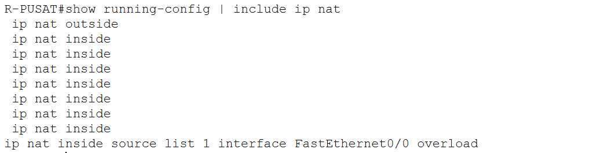

2. **Uji Akses ke Server Internet dari PC `CCTV Kota` (`ipconfig` dan `ping 8.8.8.8`):**  
   PC `CCTV Kota` (`10.120.96.10`) berhasil melakukan *ping* ke `8.8.8.8` dengan TTL 125 (melewati `R-DC`, `R-PUSAT`, dan `R-ISP`). Satu atau dua paket pertama dapat *timeout* karena proses ARP, paket berikutnya membalas.
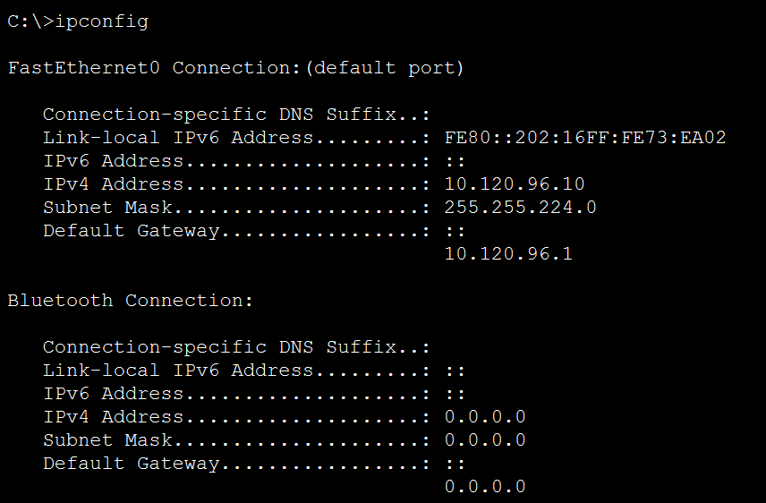
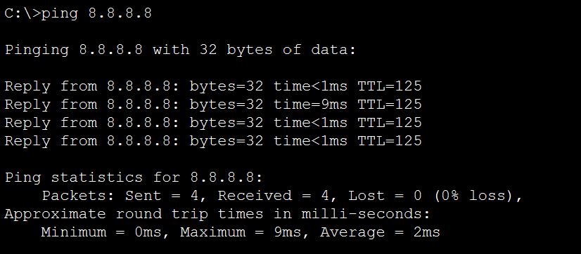

3. **Uji Akses ke Server Internet dari Berbagai Wilayah:**  
   *Ping* ke `8.8.8.8` dari PC di wilayah lain (Pegawai Balai Kota, WiFi Utara, Selatan, Timur, Barat, dan Pelabuhan) seluruhnya berhasil.

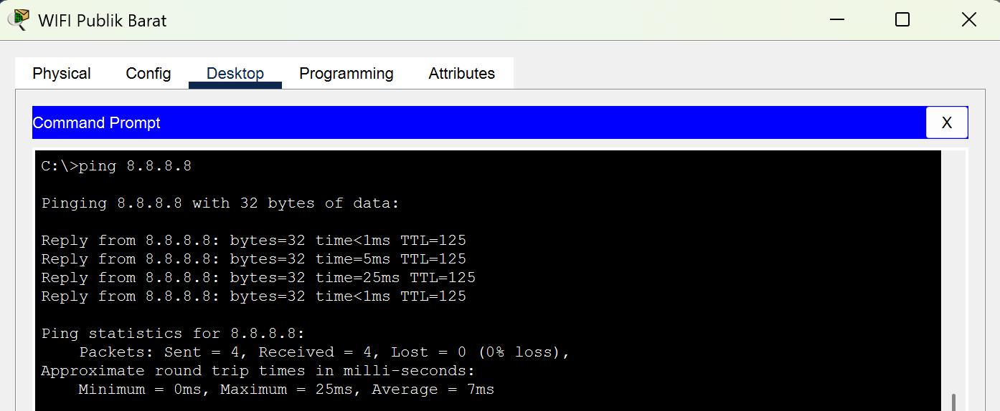
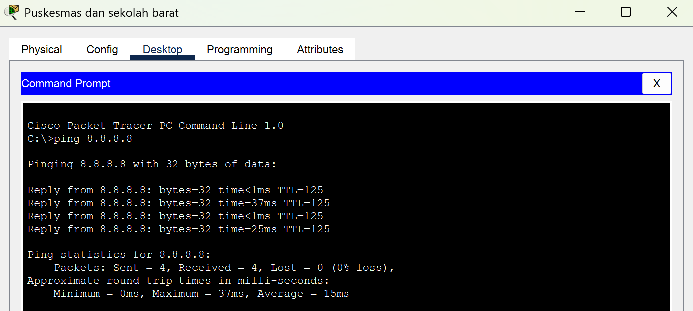
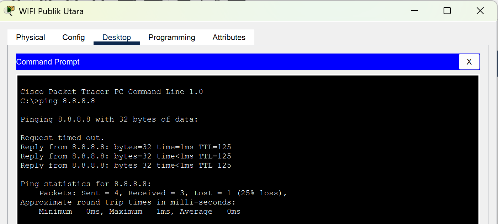
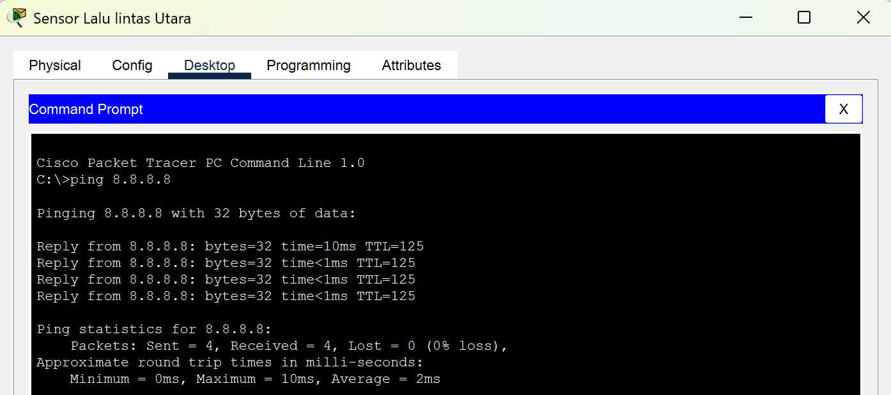
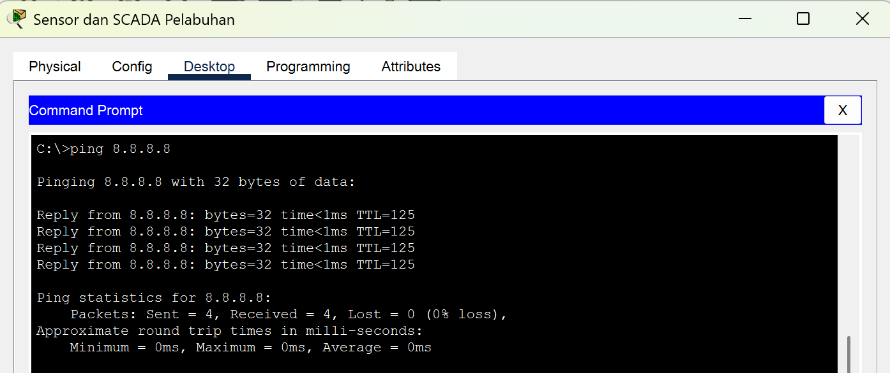
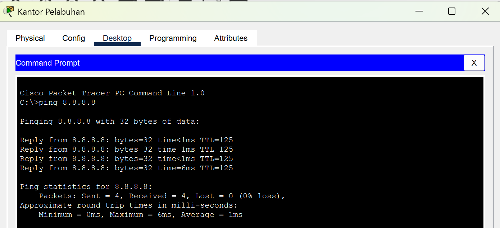
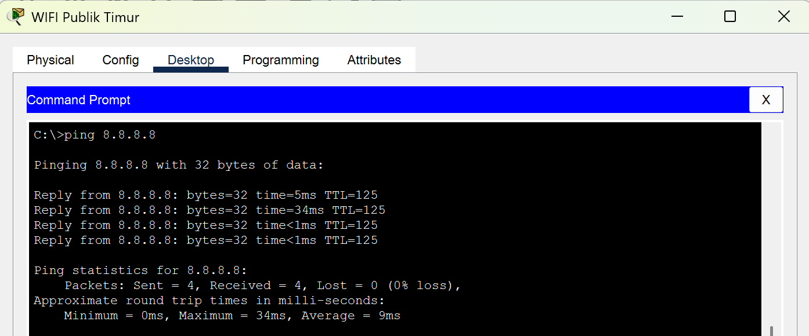

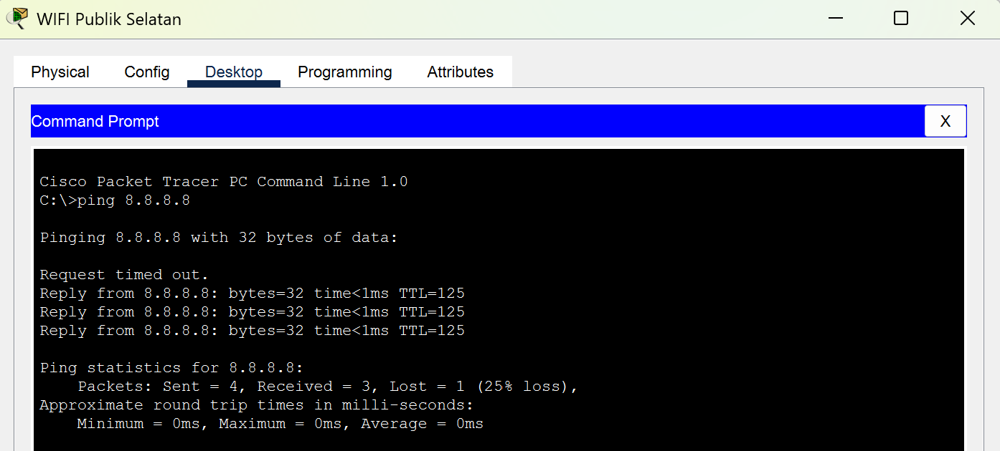


4. **Verifikasi Tabel Translasi NAT (`show ip nat translations`):**  
   Alamat privat PC `Pegawai Balai Kota` (*Inside local* `10.120.224.11`) diterjemahkan menjadi satu IP publik yang sama, `203.0.113.61` (*Inside global*), dengan nomor *port* berbeda untuk setiap sesi, menuju `8.8.8.8`. Perintah dijalankan saat *ping* masih berlangsung karena entri ICMP kedaluwarsa dalam sekitar 60 detik.
   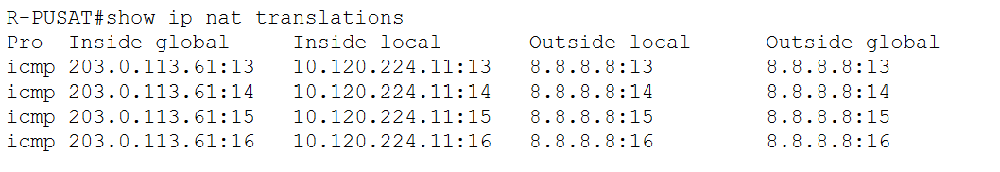


5. **Verifikasi Statistik NAT (`show ip nat statistics`):**  
   Menunjukkan *outside interface* `FastEthernet0/0`, tujuh *inside interface*, `Total translations: 8 (8 dynamic, 8 extended)`, dan angka *Hits* yang naik.
   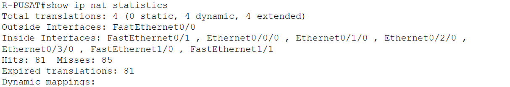

6. **Verifikasi `R-ISP` Tidak Memiliki Rute ke Alamat Privat (`show ip route` dan `ping 10.120.239.2`):**  
   `show ip route` di `R-ISP` hanya berisi dua rute *connected* (`8.8.8.0/24` dan `203.0.113.60/30`) tanpa *gateway of last resort*, dan *ping* dari `R-ISP` ke `10.120.239.2` gagal 0 dari 5 paket. Ini karena `R-ISP` hanya memiliki dua interface yang dikonfigurasi, tanpa *static route* dan tanpa *routing* dinamis.
   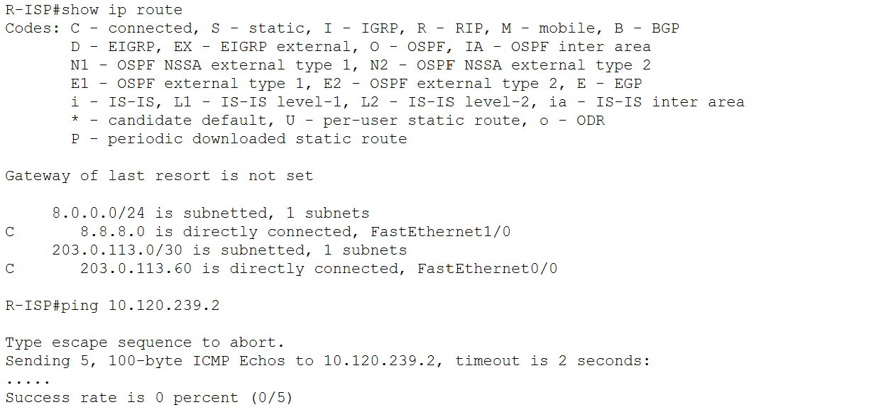

---

### 4.6 Bukti Pengujian Soal 6 (Tunnel GRE)

* **Bukti Status Interface Tunnel Up & Output `tracert` dari Balai Kota ke Pelabuhan melewati IP Tunnel:**

  

---

### 4.7 Bukti Pengujian Soal 7 (Dynamic Routing OSPF)

1. **Bukti Port Baru untuk Link L7 pada `R-DC` dan `R-UTARA` (`show ip interface brief`):**  
   Menunjukkan `Fa3/0` pada `R-DC` dan `Fa4/0` pada `R-UTARA` setelah modul `PT-ROUTER-NM-1CFE` dipasang.
   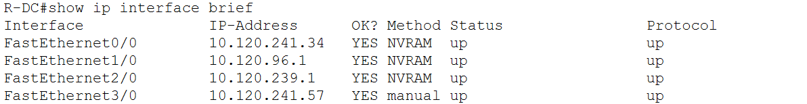
   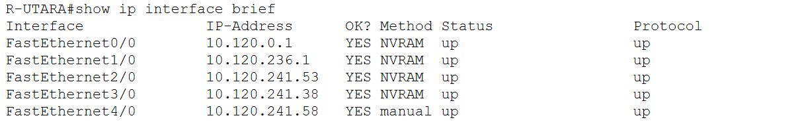

2. **Uji Konektivitas Link L7 (`ping 10.120.241.58` dari `R-DC`):**  
   Berhasil **100% (5/5)**.
   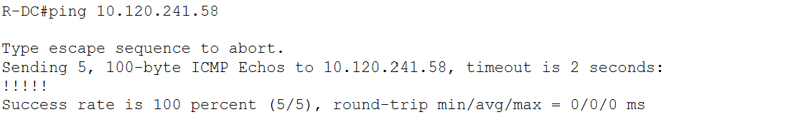

3. **Verifikasi Tetangga OSPF (`show ip ospf neighbor`):**  
   `R-PUSAT` memiliki 5 tetangga (`3.3.3.3`, `7.7.7.7`, `2.2.2.2`, `6.6.6.6`, `5.5.5.5`), `R-UTARA` memiliki 3 tetangga (`4.4.4.4`, `1.1.1.1`, `2.2.2.2` lewat L7), dan `R-DC` memiliki 2 tetangga (`1.1.1.1`, `3.3.3.3`). Seluruhnya berstatus `FULL`.
   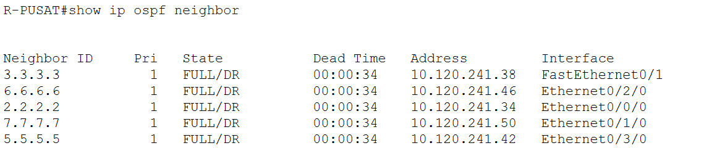
   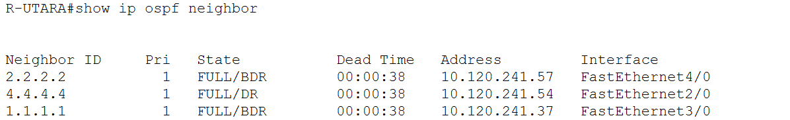
   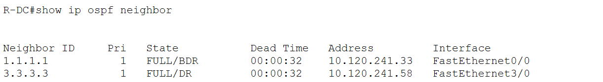

4. **Verifikasi Tidak Ada *Static Route* Tersisa (`show running-config | include ip route`):**  
   `R-PUSAT` hanya menampilkan satu baris, yaitu `ip route 0.0.0.0 0.0.0.0 203.0.113.62`. `R-BARAT`, `R-UTARA`, dan `R-PELABUHAN` kosong.
   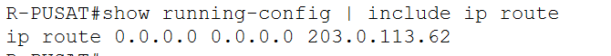
   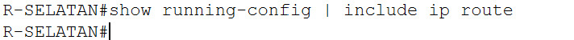
   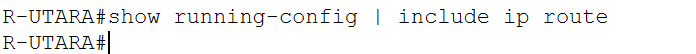
   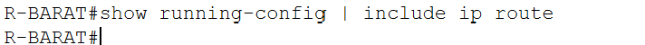
   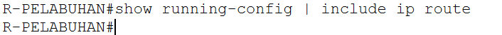
   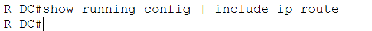
   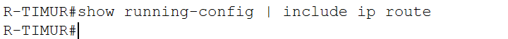

5. **Verifikasi *Default Route* Didapat Lewat OSPF (`show ip route 0.0.0.0`) dan Akses Internet:**  
   Di `R-BARAT`, `R-TIMUR`, `R-SELATAN`, dan `R-DC`, rute dikenali lewat `ospf 1` (*distance* 110, *metric* 1, *type extern 2*) dari *router-id* `1.1.1.1` (`R-PUSAT`). *Ping* ke `8.8.8.8` berhasil 5 dari 5 paket, sehingga NAT tetap berjalan bersama OSPF.
   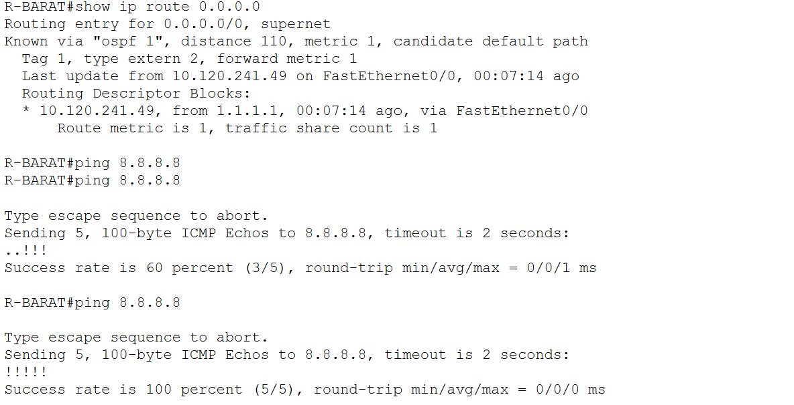
   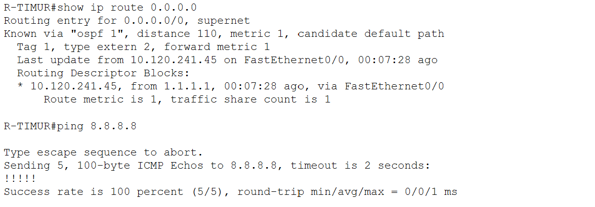
   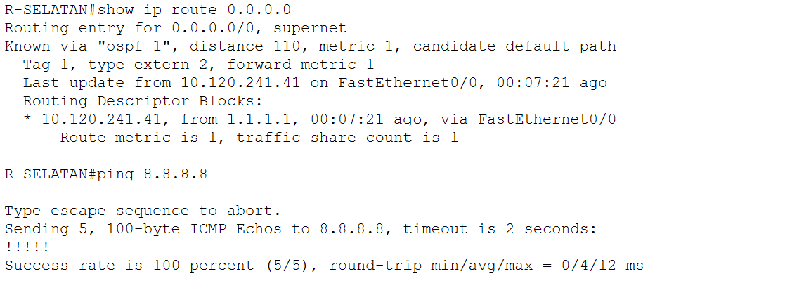
   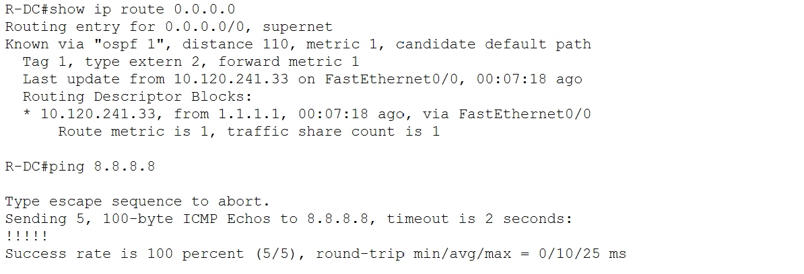

6. **Verifikasi Tabel Routing `R-PUSAT` (`show ip route`):**  
   *Gateway of last resort* `203.0.113.62`, rute ke seluruh LAN wilayah lain berkode `O`, dan satu-satunya *static route* adalah `S*` *default* ke `R-ISP`.
   
   

7. **Verifikasi OSPF Tidak Dikirim ke LAN Pengguna (`show ip protocols` pada `R-UTARA`):**  
   *Passive Interface(s)* berisi `FastEthernet0/0` dan `FastEthernet1/0` (dua LAN pengguna), sedangkan interface link (`Fa2/0`, `Fa3/0`, `Fa4/0`) tidak *passive*. *Routing Information Sources* memuat ketujuh *router-id* (`1.1.1.1` sampai `7.7.7.7`).
   

8. **Uji *Failover* Link L1 (`R-PUSAT` ke `R-DC`) Dimatikan:**  
   Pengujian dari PC `CCTV Kota` ke Server Balai Kota (`10.120.241.2`).
   * *Tracert* kondisi normal: `10.120.96.1` (`R-DC`), `10.120.241.33` (`R-PUSAT` lewat L1), `10.120.241.2`.
   
   * `ping -t` menunjukkan TTL 126, satu paket `Request timed out`, lalu balasan kembali dengan TTL 125 (satu router lebih banyak).
   
   
   * Mematikan L1 di `R-PUSAT` (`interface Ethernet0/0/0` lalu `shutdown`).
   
   * *Tracert* saat L1 mati: `10.120.96.1` (`R-DC`), `10.120.241.58` (`R-UTARA` lewat L7), `10.120.241.37` (`R-PUSAT` lewat L2), `10.120.241.2`. Koneksi pulih otomatis lewat jalur lain.
   

9.  **Kondisi Kembali Normal Setelah Link Dinyalakan (`no shutdown`):**  
    Seluruh interface `R-PUSAT` kembali `up/up`, `show ip ospf neighbor` menampilkan lima tetangga `FULL`, dan *tracert* ke `10.120.241.2` kembali lewat `10.120.241.33`.
    
    

---

### 4.8 Bukti Pengujian Soal 8 (Layanan Aplikasi Smart City)

1. **Bukti 8 - A:**

   

2. **Bukti 8 - B:**


   
3. **Bukti 8 - D:**


4. **Bukti 8 - D:**

